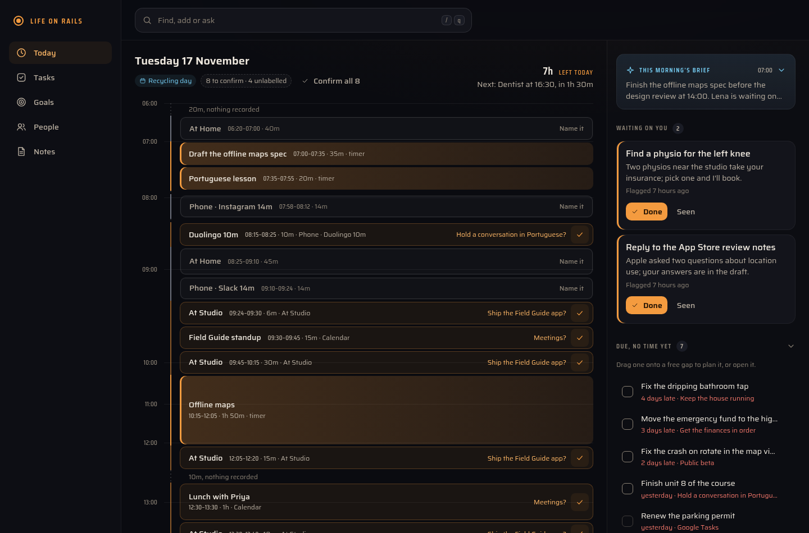
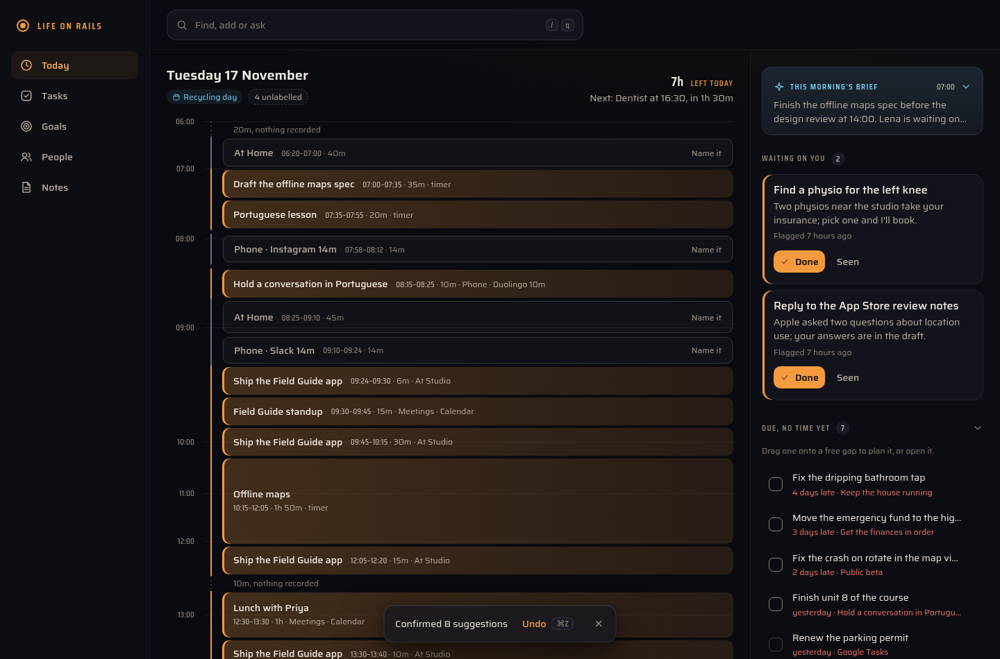

## Goal

Sumeet can use the Timeline direction's dashboard in the prototype: pick it in the Version dropdown and do the brief's ten dashboard interactions by hand, at desktop and at phone width, on the made-up data.

## Done when

- [x] `prototype/dashboard/` has a `timeline` direction, in a folder of its own with its own tokens, components and screens, built as `docs/design/lab/brief.md` describes it under "### 2. Timeline" and with the brief's "Common ground for every concept" (the one search field that also adds and asks, Sumeet's four look asks, standard controls).
- [x] It draws the brief's dashboard screens (Today in the afternoon and in the morning, Tasks with a task open, Goals with one goal at "no data yet", People with the list and one person) at 1440, 1100 and 412 px.
- [x] It draws the brief's required states that reach the dashboard (nothing wants you, an empty day at 09:00, LoR's last data shown as stale, a crowded queue), each opened by a link, and the Report says where each appears.
- [x] The brief's ten dashboard interactions work by hand at 1440 and at 412 px, Undo is offered only where the brief allows it, and the Report lists each interaction with how it is done in this direction.
- [x] `shots/prototype.json` gains this direction's screens and states, `pnpm shots` captures them, and `scripts/lab/publish.sh` puts the build and the gallery under `/lab/`.
- [x] The direction's "Its risk" from the brief is answered in the Report after using it: whether it showed up, with a screenshot.

## Scope

`prototype/dashboard/` (this direction's folder and its registration) and `shots/prototype.json`. Not the shell, not another direction's folder, not `src/`.

## Context

- Use the `refactoring-ui` skill (`~/.agents/skills/refactoring-ui/`) and the vendored impeccable skill's Operate guidance. Sumeet's aim, 2026-11-17: the app, launcher and dashboard should "feel designed and polished", "make common things easy and uncommon things accessible" and be "a delight to use"; the Elite theme is kept "only in spirit".
- Concept code is rough on purpose. The look is not: this is what Sumeet chooses from, so finish the visual design; the brief's frames in `docs/design/lab/directions/` show organisation only, and their faces are placeholders.
- The other three directions are built at the same time in their own folders. Expect to merge `shots/prototype.json` with theirs.
- T3 approvals and questions stay on the phone; no concept puts them on the dashboard.

## Report

Timeline is in the Version dropdown as "Timeline: the day is the spine" (`#/timeline/`). It is one folder, `prototype/dashboard/src/directions/timeline/`, with its own tokens (`tokens.css`), components and screens. It imports only `src/data` and `src/shell`. Outside that folder it changes one line of `directions/index.ts` and adds 15 shots to `shots/prototype.json`.

**The shell, as the brief draws it**
- **Navigation.** A left rail of pages (Today, Tasks, Goals, People, Notes). At 1100 it folds to icons. At 412 it becomes a tab row stuck to the top. I first put the tabs at the bottom, but full-page captures then drew them across the middle of the page.
- **Today.** The route runs down the centre from the first block (06:20) to bedtime (22:00), with now a third of the way down the route's own scroll. Above the line are past blocks, drawn three ways:
  - tracked: solid amber;
  - the agent's guess: amber outline with "Meetings?" and a ✓;
  - nobody's: faint dashed, with "Name it".

  Below the line are calendar events (dashed cyan), his own plans (dashed cyan) and free gaps ("1h 30m free", with "Plan a task here"). Nothing is put on the route unless he puts it there. Long empty stretches are squeezed. Short blocks get a 44 px minimum.
- **The untimed column** beside the route holds the morning brief (open before noon, one line after), Waiting on you, Due with no time, and Done today. At 412 it sits above the route, as the brief's phone agent page has it. Before now, all but the last two hours folds into one "Earlier, 06:00–12:30 · 12 blocks · 9 want a label" row, so now stays near the top.
- **No detail pane.** A block, a task or a gap opens in a frosted popover beside it, or a bottom sheet at 412. Tasks, Goals, People and Notes are ordinary pages. A goal and a person each open as their own page. A person's recent contact is drawn as a short route of its own.
- **Common ground.**
  - One search field sits on every page at every width (`/` or ⌘K, and `q` to add). Its first row is what Enter will do, with the date and `#goal` it read out of the words shown as chips. Asking the agent waits 3 s with a Cancel before it sends.
  - The four look asks: rounded corners at 8, 10, 14 and 18 px. Blur on everything that floats (popovers, the sheet, results, the notice, the top bar). Separation by tone and three depth levels instead of identical frames. Five type sizes, one job each: 12 meta, 14 body, 16 titles, 20 page and popover heads, 48 the running clock.
  - Standard controls with hover, focus, pressed and disabled states, and 180–240 ms motion.

**Screens** (each at 1500, 1100 and 412 in `pnpm shots`; I also checked 1440 by hand, since the catalogue's widest width is 1500):

| Screen | Link |
|---|---|
| Today, afternoon | `#/timeline/?still=1` |
| Today, morning | `?scene=morning` |
| Tasks with a task open | `tasks?id=Reply to the App Store review notes` |
| Goals ("no data yet" on three goals) | `goals` |
| One goal at no data yet | `goals?id=Be a good friend` |
| People | `people` |
| One person | `people?id=Maya Okafor` |

Extra shots: a block open to relabel (`?block=13:00`), switching the timer (`?block=14:13`), quick add, and search results.

**States and where each appears**
- **Nothing wants you** (`?scene=quiet`): Waiting on you becomes a card, "Nothing is waiting on you. No flags, nothing due. Next on the route: Dentist at 16:30."
- **An empty day at 09:00** (`?scene=empty`): above the now line, the route says "Nothing recorded yet today. Start a timer, or LoR fills this in from your phone and calendar as the day goes." The now line carries "Start a timer here", with room left under it so it never covers a block.
- **LoR unreachable, last data stale** (`?state=stale`):
  - A red banner on every page says when LoR last sent data (14:22, 38 min before) and that changes are off until it answers. It has a Try now button.
  - On the route, a hatched band from 14:22 to now reads "No word from LoR since 14:22". The running clock stops at 14:22.
  - Every write control is disabled. Search still reads the last data, and adding and asking say why they wait.
- **A crowded queue of twelve** (`?state=crowded`): Waiting on you shows a filled count of 12, the oldest four cards (two at 412), and "8 more waiting, oldest first" ("10 more" at 412).
- **Both links are faked.** The shared scenes have neither state, and no store action raises a flag. `state=crowded` lays notes over ten real open tasks (`lib/day.ts`), so Done goes through the store and Seen is kept in the direction. `state=stale` is a view-only flag. Each direction has to fake these two its own way.

**The ten interactions, and how each is done here.** I drove all ten in Chrome against the dev server at 1440, 1100 and 412 (scratchpad `flow.mjs`, 15 checks each). All pass, with no page errors. Drag-to-plan and ⌘Z were checked separately (`drag.mjs`).

| # | Interaction | How it is done here | Undo? |
|---|---|---|---|
| 1 | Add a task | `q` (or the Add a task button), then type "call the plumber fri #Keep the house". The first row reads Add task · Fri 20 Nov · Keep the house running. | Yes |
| 2 | Tick a task, and untick it | The checkbox on any row (Today's column, Tasks, a goal). A ticked task moves to Done today, where it can be unticked. A Google Tasks row's box is disabled and says to tick it there. | Yes |
| 3 | Open a task and change its due date | Open a task from its row, then pick a date chip (Today, Tomorrow, Mon) or the date field. Today's flag and due rows open their task too. | Yes |
| 4 | Mark a flagged item done | Done on the card. | Yes (Seen too) |
| 5 | Start a timer, and stop it | "Start a timer here" on the now line, or "Start a timer" in the top bar on other pages: it starts and grows from the now line. Stop is on the running block, or on the top-bar chip from any other page. | No |
| 6 | Relabel a block of time | Press a block and pick a recent-label chip, or find any goal, project, habit or task. A guess confirms with its ✓, or "Confirm all 8" in the header. | Yes |
| 7 | Search, and open a result | Type in the field, Enter or click. A task opens on Tasks with its popover, a person or goal opens its page, a note opens in Notes. | n/a |
| 8 | Open a person | People, then a row. | n/a |
| 9 | Switch a running timer | Switch on the running block or the top-bar chip, then pick a label. The block ends now and a new one starts. "Relabel this block instead" is a link under it. | No |
| 10 | Undo a relabel | Undo in the notice, or ⌘Z. | n/a |

- **Planning onto the route.** Drag a due row onto a free gap (desktop), or use "Plan a task here" on the gap or "Today's route" in a task's popover (touch). "Take off" removes a plan. Both offer Undo.
- **How Undo is limited.**
  - It is offered only for changes LoR can reverse (`lib/ui.ts` `reversible`).
  - It is withdrawn as soon as any later change lands, so it never takes back something other than what it names. ⌘Z does only what the visible Undo would.
  - Start, stop and switch say what happened without Undo, because nothing in `src/server` reopens a closed block.
  - Ask has a 3 s Cancel before sending and no Undo after.

**Shots and publish**
- **Shots.** `shots/prototype.json` gains 15 timeline shots (45 images). I ran `pnpm shots --catalogue shots/prototype.json --base http://127.0.0.1:3862 --only "timeline: …"` in seven batches into the scratchpad. Every batch reported `problems: []`.
- **Publish.** `pnpm proto:build` then `LOR_LAB_DIR=<scratch> scripts/lab/publish.sh` put the build at `dashboard/` (with Timeline in it) and the gallery at `shots/`. The built page works under `vite preview`. I did not publish to the real `/lab/` from this checkout: it would serve a dashboard with only `current` and Timeline, replacing whatever another direction published, and the default shots folder is shared by all four checkouts. The real publish and gallery run belong on `main` after the four merges.
- **Merging.** `shots/prototype.json` gains one block appended at the end in the file's one-line-per-shot form, so it should merge with the others by hand in a minute.

**Its risk: "on a day that is mostly unlabelled, the route asks more than it tells". It showed up.** In the afternoon scene, 12 of the 16 blocks before 15:00 ask for something: 8 agent guesses and 4 nobody's.

Scrolled to the morning, the route is a column of "Ship the Field Guide app?", "Meetings?" and "Name it". Every block is labelled with where it came from, so it still tells what happened ("At Studio 09:24–09:30"), but the first read is "answer me". Two things in this build keep the asking cheap:
- the header names the debt ("8 to confirm · 4 unlabelled") with one "Confirm all 8" (one Undo takes back all 8);
- at 412, the morning folds into one row that counts what wants a label.

After one press only the 4 "Name it" blocks ask, and the route reads as a day. The bet holds only while the agent's rules guess most blocks. On a day without guesses every block would be a "Name it" with no batch answer. Before choosing this direction, ask whether that day happens.

**Left out, rather than drawn dead**
- Earlier and later days, because the snapshot holds one.
- Habits and metric check-ins on Today.
- Status.
- Clicking a calendar event (it is read-only and opens nothing).
- People's mail routing.

### Responses

2-mqfl.1: fixed in 451f0cd
2-mqfl.5: fixed in 451f0cd
