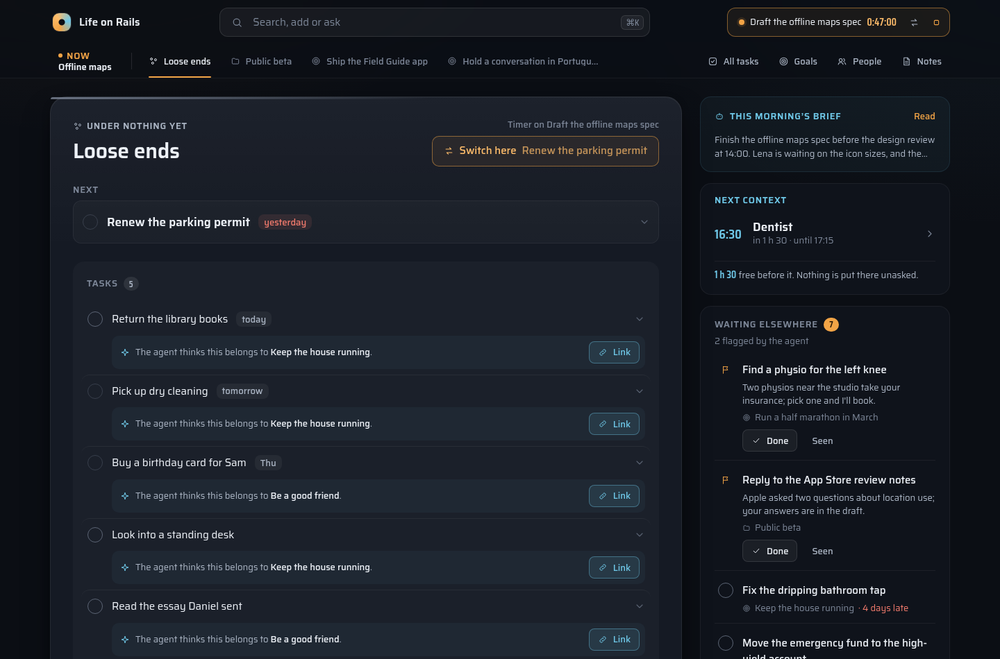
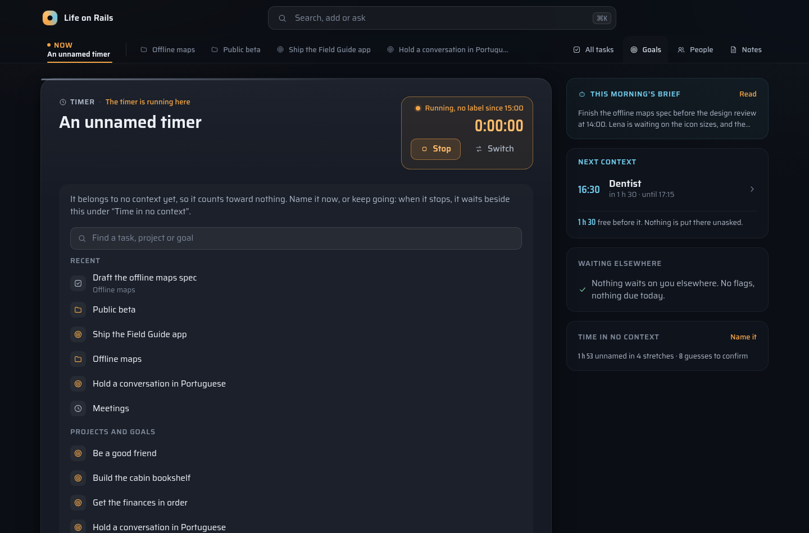

## Goal

Sumeet can use the Context direction's dashboard in the prototype: pick it in the Version dropdown and do the brief's ten dashboard interactions by hand, at desktop and at phone width, on the made-up data.

## Done when

- [x] `prototype/dashboard/` has a `context` direction, in a folder of its own with its own tokens, components and screens, built as `docs/design/lab/brief.md` describes it under "### 4. Context" and with the brief's "Common ground for every concept" (the one search field that also adds and asks, Sumeet's four look asks, standard controls).
- [x] It draws the brief's dashboard screens (Today in the afternoon and in the morning, Tasks with a task open, Goals with one goal at "no data yet", People with the list and one person) at 1440, 1100 and 412 px.
- [x] It draws the brief's required states that reach the dashboard (nothing wants you, an empty day at 09:00, LoR's last data shown as stale, a crowded queue), each opened by a link, and the Report says where each appears.
- [x] The brief's ten dashboard interactions work by hand at 1440 and at 412 px, Undo is offered only where the brief allows it, and the Report lists each interaction with how it is done in this direction.
- [x] `shots/prototype.json` gains this direction's screens and states, `pnpm shots` captures them, and `scripts/lab/publish.sh` puts the build and the gallery under `/lab/`.
- [x] The direction's "Its risk" from the brief is answered in the Report after using it: whether it showed up, with a screenshot.

## Scope

`prototype/dashboard/` (this direction's folder and its registration) and `shots/prototype.json`. Not the shell, not another direction's folder, not `src/`.

## Context

- Use the `refactoring-ui` skill (`~/.agents/skills/refactoring-ui/`) and the vendored impeccable skill's Operate guidance. Sumeet's aim, 2026-11-17: the app, launcher and dashboard should "feel designed and polished", "make common things easy and uncommon things accessible" and be "a delight to use"; the Elite theme is kept "only in spirit".
- Concept code is rough on purpose. The look is not: this is what Sumeet chooses from, so finish the visual design; the brief's frames in `docs/design/lab/directions/` show organisation only, and their faces are placeholders.
- The other three directions are built at the same time in their own folders. Expect to merge `shots/prototype.json` with theirs.
- T3 approvals and questions stay on the phone; no concept puts them on the dashboard.

## Report

Context is in the Version dropdown as "Context: everything about what you are doing" (`#/context/`). It lives in one folder, `prototype/dashboard/src/directions/context/`, with its own tokens (`tokens.css`), components and screens, and imports only `src/data` and `src/shell`. Outside that folder it changes one line of `directions/index.ts` and adds 18 shots to `shots/prototype.json`.

**The shell, as the brief draws it**
- **Navigation.** A bar with the search field and the timer, and under it a row of contexts like tabs: Now (with the current context's name and a live dot), then the projects, goals and people he opened or timed lately, then All tasks, Goals, People and Notes. At 412 the pages come right after Now as icons, so nothing common sits off the edge of the scrolling row.
- **The first view.** Now is the current context, picked in this order:
  1. what the running timer is on;
  2. what he stopped in the last 20 minutes, so it does not jump away under him;
  3. the agent's one thing (named by title in `lib/model.ts`, since the snapshot does not record it; the quiet scene has none);
  4. the last thing timed.

  A task's context is its nearest project or goal.
- **The surface.** One raised surface holds the context's title and timer, then the next task (what leads), then its regions, each on its own tone: Tasks, Given to the agent (each linking to its T3 thread, which stays in T3), Page, People, Habits and Time. Uncommon things (targets, a person's cadence and contact details) are folded at the bottom. A task opens in place. The context's page opens in the right half at 1440 and 1100, and in a sheet at 412.
- **Beside it, flat:** the morning brief (open before noon, one line after), the next context (the next fixed event, how long until it, and the free time before it), Waiting elsewhere (LoR's flags with Done and Seen, then tasks due today or late), and Time in no context.
- **Every kind of context uses the same surface.**
  - Project and goal: `/project?id=…`, `/goals?id=…`.
  - Person: `/people?id=…`, with what was said lately, the tasks that name them, their page and the pages they are part of.
  - The next fixed event as a slot: `/slot?id=…`.
  - Loose ends, for tasks under nothing: `/loose`.
  - An unnamed timer.
- **The signature move.** A context arrives as a whole: the surface settles and its regions follow 40 and 80 ms behind (240 ms in all). Motion is off with `still=1` and for reduced motion.
- **Common ground.**
  - **One field.** It finds, adds and asks on every page at every width (`/` or ⌘K, `q` to add). Its first row is what Enter does. A day word or `#goal` turns the text into "Add task" and reads back the date and parent as chips. In add mode a task with no `#` goes into the context on show, with a × to take it out. Asking waits 3 s with Cancel, then sends with no Undo.
  - **Rounded corners**, rounder the larger and nearer: 8, 10, 12, 16, 20 and 24 px.
  - **Transparency.** Blur on the bar, popovers, sheets, the page reader and the notice. Search results are 96% opaque, because Chrome cannot blur a second time inside the blurred bar.
  - **Separation by tone and depth.** The context is the only raised surface; regions sit on tones inside it, and everything beside it is flat.
  - **Five type sizes:** 13 labels, 15 body, 17 the next task, 20 heads, 30 the context's title and its clock (condensed numerals).
  - **Standard controls**, with hover, focus, pressed and disabled states.

**Screens** (each at 1500, 1100 and 412 in `pnpm shots`; I also drove 1440 by hand):

| Screen | Link |
|---|---|
| Today in the afternoon (Now: Offline maps, timer 47 min, two flags) | `#/context/?still=1` |
| Today in the morning, with the brief | `?scene=morning` |
| Tasks with a task open | `tasks?id=Reply to the App Store review notes` |
| Goals (three at "No data yet") | `goals` |
| A goal at no data yet, as its context | `goals?id=Be a good friend` |
| People | `people` |
| A person | `people?id=Maya Okafor` |

Extra shots: the page in the right half (`?page=projects/offline-maps`), the next context (`slot?id=Dentist`), Loose ends (`loose`), relabel (`?block=07:00`), switch (`?timer=switch`), search (`?q=lisbon`) and add (`?add=…`).

**States, and where each appears**
- **Nothing wants you** (`?scene=quiet`). Now opens on the last thing timed ("Where you left off"), with Start on its next task. Waiting elsewhere reads "Nothing waits on you elsewhere. No flags, nothing due today." The next context still shows the Dentist at 16:30.
- **An empty day at 09:00** (`?scene=empty`). Now opens on the one thing. Its Time region reads "None today … Nothing recorded here today. Start the timer on it, or LoR fills in phone and calendar time as the day goes." Beside it, a "Time today" card says nothing is recorded yet.
- **LoR unreachable, last data stale** (`?state=stale`).
  - A red banner on every page says LoR last answered at 14:22, 38 min before, and that changes are off. It has a Try now button.
  - The running clock stops at 14:22 (0:09:00), and every write control is disabled.
  - Search still reads; adding and asking say why they wait.
  - `state` is kept by the direction's own links (`lib/nav.ts`), so changing page does not fake a recovery.
- **A crowded queue** (`?state=crowded`). Twelve flags (2 real, 10 made-up notes laid over real open tasks in `lib/model.ts`) plus 3 due tasks wait under Waiting elsewhere, with a filled count. The oldest four show (three at 412) with "11 more waiting, oldest first". Done goes through the store. Seen on a made-up flag is kept in the direction, because the store cannot raise a flag.

**The ten interactions, and how each is done here.** A script drove all ten in Chrome against the dev server at 1440, 1100 and 412, plus Stop from another page and stale navigation: 12 checks per width, all passing, no page errors, no sideways scroll.

| # | Interaction | How it is done here | Undo? |
|---|---|---|---|
| 1 | Add a task | `q` (or Add in a context), then "Call the plumber fri #Keep the house". The first row reads Add task · Fri 20 Nov · Keep the house running. | Yes |
| 2 | Tick, and untick | The round box on any row. In a context a ticked task moves to Done today, where it unticks. A Google Tasks row's box is disabled and says to tick it there. | Yes |
| 3 | Open a task, change its due date | Press its title: it opens in place with day chips and a date field. Rows in Waiting elsewhere open the task in its own context. | Yes |
| 4 | Mark a flagged item done | Done on the flag in Waiting elsewhere, or the box on the task. | Yes (Seen too) |
| 5 | Start a timer, and stop it | Start in a context's header (on its next task), Start a timer on any task, or Start a timer in the bar on any page (with "Start without a label"). Stop is in the header, or on the bar's chip from every other page. | No |
| 6 | Relabel a block of time | Relabel on a block in a context's Time region, or Name it on a block under Time in no context. Then pick from one picker (recent first). The block moves to that context's time. A guess has ✓ or "Something else". | Yes |
| 7 | Search, and open a result | Type, then Enter or click. A project, goal or person opens as its context; a task opens in its context, opened in place; a note opens in Notes. | n/a |
| 8 | Open a person | People, then a row, or any person in a context's People region. | n/a |
| 9 | Switch a running timer | Switch in the header or the bar chip, then pick. The block ends now and a new one starts. Now turns to the new context. "Relabel the whole block instead" sits under the picker. | No |
| 10 | Undo a relabel | Undo in the notice, or ⌘Z. | n/a |

- **How Undo is limited** (`lib/ui.ts`). `reversible` offers Undo, and any later change withdraws it, so Undo never takes back something it does not name. ⌘Z does only what the Undo on show would. Start, stop and switch say what happened with no Undo, because nothing in LoR reopens a closed block. Asking has a 3 s Cancel and no Undo.
- **Two bugs the script found, both fixed.**
  - Keys typed straight after `/` or `q` were lost, because the field took focus a frame late.
  - At 412 the notice covered the next row's checkbox. It now sits at the bottom (at the top while a sheet is open), and only its buttons take a press.

**Shots and publish**
- **Shots.** `shots/prototype.json` gains 18 `context` shots (54 images). I ran `node scripts/shots.mjs --catalogue shots/prototype.json --base http://127.0.0.1:3864 --only "<name>"` once per shot, into `~/.cache/lor-vujy/gallery`. Every run reported `problems: []`, and I checked all 54 images on contact sheets: none repeats the top of the page.
- **/tmp is quota-limited.** This session's /tmp gives error -122 (quota) on screenshot writes. That is the "screenshot-write error -122" Timeline's reviewer hit, so write shots to a directory on disk.
- **Publish.** `pnpm proto:build`, then `LOR_LAB_DIR=~/.cache/lor-vujy/lab scripts/lab/publish.sh`. That published `dashboard/` (Context in it) and `shots/`, and the published page opens `#/context/` with no errors. I did not publish to the real lab: the lead publishes from main after the merges.
- **Merging.** `shots/prototype.json` gains one block at the end in the file's one-line-per-shot form.

**Its risk: it showed up, on this data and in two ways.**

1. **A task with no project has nowhere obvious to live.** 7 of the snapshot's 33 open tasks sit under nothing, among them "Renew the parking permit", due today. Time does the same: in the afternoon, 1 h 53 in 4 stretches nobody named, and 8 agent guesses, belong to no context.
2. **A timer with no label has no context.** Phone time and a timer started without a label have no context to sit in.

What this build does about it:
- **Loose ends is a context of its own**, reached from All tasks and from any loose row in Waiting elsewhere. Each task in it carries the agent's suggested link ("The agent thinks this belongs to Keep the house running · Link"). Link is one press with Undo. The suggestions are made up by title in `lib/model.ts`, since the store holds none.
- **Time in no context** sits beside every context, with "Name it" on each stretch and ✓ on each guess.
- **A timer with no label becomes a context of its own**, with the picker in place. It says it counts toward nothing until it has a name.

These keep the unlinked things findable, but they are a bucket, not a context: Loose ends has no page, no people and no week. The direction is only as good as the links. On a week where the agent does not propose links, Loose ends and Time in no context would grow, and Now would have little to gather. Before choosing this direction, ask whether the agent will keep things linked.

The brief's other half of the risk, home's card taking space from icons, is the phone mockup's question, not the dashboard's.

**Left out, rather than drawn dead**
- A thread reader: T3 threads only link out (`t3://`, which does nothing in the prototype).
- Editing pages, goal targets, weights and mail routing.
- Metric check-ins.
- Status.
- Earlier and later days, since the snapshot holds one.
- Week hours for a project: they come only from its goal, because the store keeps no project week until a block stops.
