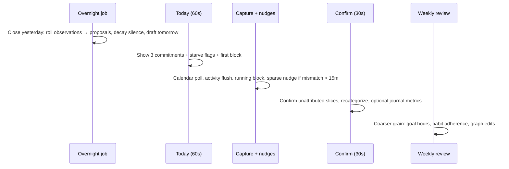
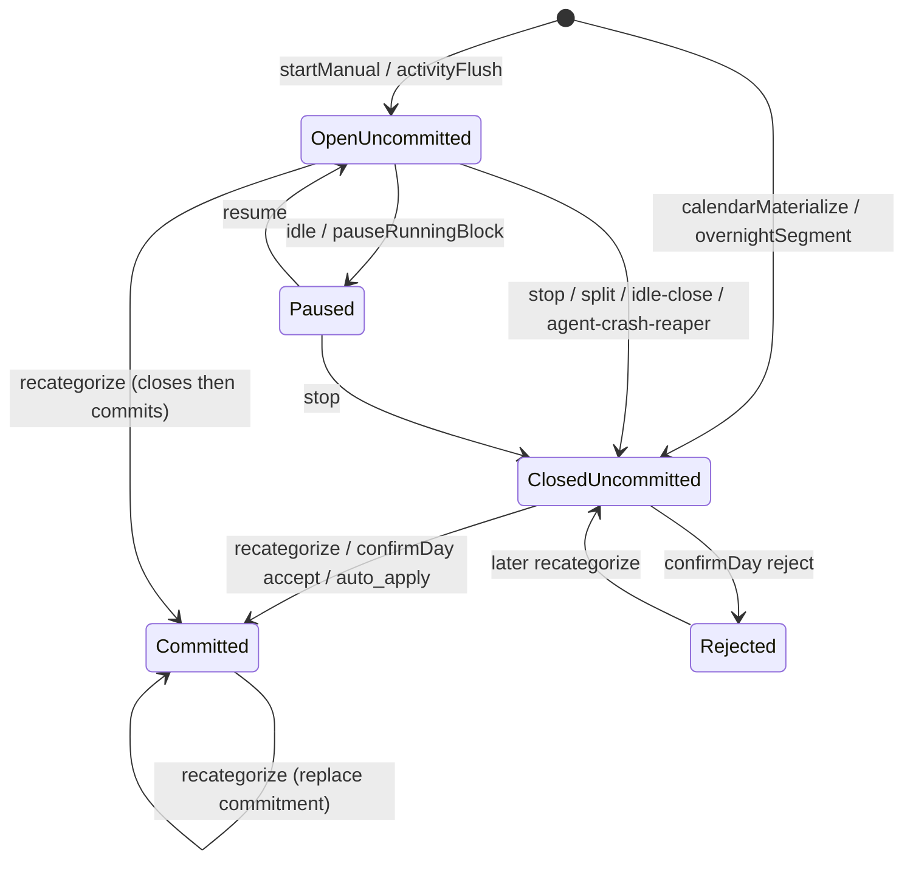
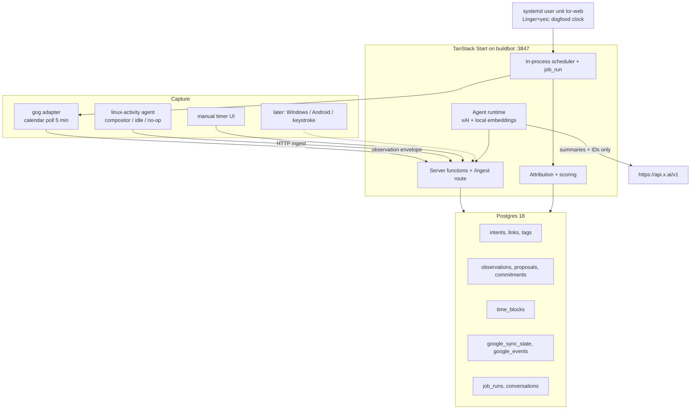

# Life on Rails v2 — Product + Engineering Spec

| Field | Value |
| --- | --- |
| **Document** | Combined product and engineering specification |
| **Product** | Life on Rails v2 (self-hosted personal operating system) |
| **Author** | Sumeet Padavala |
| **Date** | 2026-10-12 |
| **Status** | v1 locked (open questions resolved 2026-10-12; review fixes applied — see git log) |
| **Workspace** | `/home/supadava/projects/life-on-rails` |
| **Dogfood host** | `buildbot` (Ubuntu 26.04.1 LTS, kernel 7.0.0-38-generic, x86_64, Tailscale `100.124.153.80`) |
| **Predecessor** | 2023 T3/Clerk/PlanetScale SaaS draft, last commit `e7c4b61` (2023-06-14) |
| **Also draws on** | 2026 Gemini planning artifact: ADHD / executive-dysfunction super-app (philosophy + prior art + later modules). Stack and v1 scope in *this* document win when the two conflict. |

---

## Overview

Life on Rails v2 is a **self-hosted personal operating system** whose job is to close the loop between what you intend and what you actually do. The 2023 product was a multi-tenant SaaS habit/goal tracker (Next.js pages router, Clerk, PlanetScale MySQL, Prisma + Drizzle, tRPC). That codebase is a **rough draft and a bad one**. v2 does not extend it. We salvage only the *ideas*: a directed graph of goals, habits, and metrics; weighted rolling scores; a daily journal; and templates as graph seeds.

The v1 wedge is an **intention-aware time tracker** that replaces Toggl for the author. Toggl is a billing stopwatch: it does not know the calendar, the routines, or which goals are starving. Life on Rails does. Three layers:

1. **Capture** — calendar (Google via `gog`) and desktop/mobile activity, plus a manual timer override.
2. **World model** — goals, projects, habits, tasks, metrics, links, scores. The spine of the product.
3. **Agent** — chat/voice that reads the model and observations, proposes links and day plans, and applies commitments only behind a confirm gate.

Primary success metric: **share of waking hours attributed to a world-model node**, and whether **high-weight goals receive enough hours**. On the current headless `buildbot` that metric is **not** “0.7 of 14 h of auto-tracked desktop time.” Until a graphical session exists, the dogfood path is **calendar-proposed actuals + evening confirm + manual timer**; coverage is measured against the calendar wake window, not empty activity.

The user the system is *for* is someone with executive dysfunction (ADHD or similar): time blindness, working-memory overflow, and a shame cycle when a tracker becomes homework. The app is an **externalized prefrontal cortex**, not a rigid task list that tries to straighten them out. Kaizen: sustainable small improvements and fast recovery from collapse, not perfect streaks.

This document is written so an engineer who was not in the planning conversation can implement it on `buildbot`.

---

## Background & Motivation

### Why revive

The author already lives in Google Calendar and a desktop. Time is the scarce resource; spending it productively is the actual goal. Existing tools fail in complementary ways:

| Tool class | What it has | What it lacks |
| --- | --- | --- |
| Toggl / Clockify | Manual/auto timers | Intention (what you *should* be doing) |
| Todoist / Things | Frictionless capture, NLP dates | Calendar + time evidence; context-switch to notes |
| Notion | Flexible databases | High setup friction; the system *is* the work |
| Motion | Autopilot schedule | Overschedule/burnout; no actuals |
| Sunsama | Mindful daily load | High manual planning ritual |
| Tiimo / Structured | Now/next visual time | Weak integrations |
| Finch / Habitica | Dopamine loop | Fake rewards rot; not a continuity system |
| Gemini + Google Tasks | Voice mutate tasks | No world model, no actuals |
| Rewind / ActivityWatch | High-fidelity activity | Intentional structure |
| ChatGPT-as-PA | Language | A continuously updated life dataset |

Life on Rails is the missing join: **structure + evidence + a grounded agent**, designed so maintaining the system is cheaper than abandoning it.

### Philosophy: externalized executive function

The Gemini artifact’s research claim, adopted here: traditional planners assume a neurotypical prefrontal cortex. For ADHD, **infrastructure friction** (categorize, tag, date, catch up) is energy stolen from the work. A few days of slip become a backlog **Wall of Shame**; avoidance; a fresh notebook; systemic instability.

Design consequences (normative UX law, Decision 17):

| Struggle | Manifestation | What LoR does |
| --- | --- | --- |
| Time blindness (prospective) | Planning fallacy | Later: agent duration estimates from *your* actuals + an ADHD buffer. v1: hour targets on goals, starve flags. |
| Time blindness (retrospective) | “Where did the day go?” | Automatic observations + evening timeline. Headless v1: calendar-as-proposed-actual. |
| Time blindness (present) | Waiting mode; no sense of remaining day | Today shows remaining wake window as a **visual quantity** (bar / radial), not only a clock. Gap chips between events are first-class (micro-task sized). |
| Working memory | Capture or it vanishes | Chat/voice dump; one-tap recategorize; Todoist-like capture is a v2+ polish on Chat, not a second app. |
| Object permanence | Out of sight, out of mind | v1: Today is the only home. Later: ambient always-on display (tablet / e-ink / phone dock). |
| Shame cycle | Overdue list → delete the app | **Safe failure:** `Reset Visibility` archives overdue into `Later` without deleting history. Trends over streaks. AI tone: effort and recovery, not “you failed yesterday.” |
| Decision fatigue | What next? | Morning Today: three things only. Motion-style full autopilot is **out** (burnout). Gentle guidance: easy to move blocks, not a locked schedule. |

**Kaizen.** Success is recovering from a focus collapse quickly and improving the week-over-week hour mix, not a 30-day flame icon.

**Life in weeks.** [Wait But Why — The Tail End](https://waitbutwhy.com/2014/05/life-weeks.html): a 90-year grid of weeks. Every committed week is a square you spent. This is a **Graph / weekly-review view (PR 9+)**, not the Today home. It is how moment-to-moment blocks get meaning. Do not put a 90-year calendar on the morning screen.

**Objective + subjective.** Time blocks and calendar are objective. Metrics (mood, energy, “how did that session feel”) are subjective. Scoring already mixes both; the evening confirm may attach one metric prompt, never a form.

**All-in-one, with a low floor.** Jumping between Toggl + Todoist + Notion *is* the friction. Optional modules (CRM, photos, Tesla, health) exist so the ceiling is high; **none of them are v1.** Onboarding is capture + calendar + Today only.

**Self-hosted does not mean “ignore privacy.”** The Gemini note that a technical self-hoster can ignore privacy is **rejected for LLM egress**. The database stays on `buildbot`. Prompts still get summaries and IDs (Decision 10). Device capture remains opt-in per agent.

### Prior art (what we take, what we refuse)

| Take | From | Refuse |
| --- | --- | --- |
| Natural-language capture | Todoist, Gemini×Tasks | Building a second GTD app before Today works |
| Now/next + visual time | Tiimo, Time Timer | Icon-only childish UI |
| Realistic daily load | Sunsama | Mandatory 20-minute planning ritual |
| Autopilot reschedule | Motion | Surrendering the calendar to the model in v1 |
| Cross-device distraction shield | Focus Bear | Shipping a blocker in v1 |
| Pet/RPG gold | Finch, Habitica | Fake coins, streaks-as-morality |
| Life-weeks grid | Wait But Why | Using it as the daily surface |
| Passive ingest | Health Connect, UsageStats, Tesla Fleet | Any of those sensors in v1 |
| Photos as memory | Google Photos | Library-wide scrape (Picker-only if we ever do photos; `photoslibrary.readonly` is restricted) |
| Agent that can write extensions | “PI harness” / self-modifying OSS | Agent-writes-production-code in v1. High-ceiling later; review gate. |

### Current state of the 2023 draft (do not extend)

Repo `spadaval/life-on-rails`, 446 commits, last commit 2023-06-14 by Sumeet Padavala. Surfaces in `src/pages/` and nav in `src/components/layout/index.tsx`:

- Journal (`/journal`) — daily habit completions + metric answers
- Overview (`/overview`) — all goals/habits/metrics with scores
- Dashboard (`/dashboard`) — pie/line charts of completions
- Timeline (`/timeline`) — create/archive *item* events, **not** a time tracker
- Templates (`/templates`) — hardcoded fitness / productivity / peace seeds in `src/server/api/routers/templates.ts`
- Marketing landing (`/`), Clerk sign-in/up, PWA, Netlify-oriented `middleware.ts` (`regions: ["sfo1"]`)

Stack to discard: Next 13 pages+app hybrid (`next.config.mjs` enables **both** `experimental.appDir` **and** `i18n`, which Next itself documents as incompatible — see the comment citing vercel/next.js#41980), Clerk (`src/server/auth.ts`, `src/middleware.ts`), PlanetScale MySQL (`src/server/db.ts` dual Prisma-edge + Drizzle serverless), tRPC (`src/server/api/root.ts`), Prisma (`prisma/schema.prisma`). The 2023 tree is **npm** (`package-lock.json`); v2 uses pnpm. Drizzle was already in use (`src/schema/schema.ts`) against MySQL enums — keep the *ORM choice*, not the MySQL schema.

Launch copy in `src/app/blog/intro/intro.mdx` already promised “integrations with third-party tools to automatically track habits” and an “AI Coach.” Those were vapor. v2 makes them the product, for one user, on one box.

### Pain in the 2023 scoring (cite, then reimplement)

`src/server/queries.ts`:

- **Metric score** (`getMetrics`, ~lines 237–242): `(answer_count / 5) / (7 * scoringWeeks)`. This is a *logging-rate* proxy. It ignores `MetricAnswer.value` and `score` entirely. Broken as a quality signal.
- **Habit score** (`getHabits`, ~lines 129–142):

  ```
  normalizedFrequency = WEEK ? frequency : frequency * 7
  completionScore     = count / (normalizedFrequency * scoringWeeks)
  metricsScore        = avg(linked metric scores)
  score               = completionWeight * completionScore
                      + (1 - completionWeight) * metricsScore
  ```

  Completions for the attached habit object are only last 7 days (`gt(subDays(date, 7))`), while the score window is `scoringWeeks * 7`. Inconsistent.
- **Goal score** (`getGoals`, ~lines 318–332): weighted average of linked habit and metric scores. No empty-child guard, no time spent, no decay on silence.

v2 keeps the *shape* (habit mixes adherence + quality; goal is a weighted mix of children) and fixes the semantics. Line-by-line port is forbidden.

### Host facts (verified 2026-10-12)

| Fact | Value |
| --- | --- |
| Hostname | `buildbot` |
| OS | Ubuntu 26.04.1 LTS (Resolute), kernel 7.0.0-38-generic, x86_64 |
| RAM / disk | 11 GiB RAM (~10 GiB available), 73 GiB free on `/` |
| GPU | AMD Rembrandt Radeon 680M (present; not required for v1) |
| Node / pnpm | v22.20.0, pnpm 10.34.6 at `/home/supadava/.local/bin/pnpm` |
| Bun / Docker / Postgres | **Not installed.** No `psql`, no `docker`, no `podman`. |
| Postgres via apt | Candidate `postgresql` 18+290ubuntu1; `postgresql-18`, `postgresql-client-18`, `postgresql-18-pgvector`, `postgresql-18-cron` all in archive |
| Desktop session | **None.** `XDG_SESSION_TYPE` / `XDG_CURRENT_DESKTOP` / `WAYLAND_DISPLAY` / `DISPLAY` empty. `loginctl` shows a `manager` class session, no `seat0`. No Hyprland/Sway/GNOME/KDE processes. `libwayland-client0` is installed; no compositor. |
| ActivityWatch | Not installed |
| Tailscale | `100.124.153.80  buildbot` (linux), `legend` (Windows, `100.65.194.111`), `pixel-9a` (Android, `100.83.51.27`) |
| Tailscale Serve | Already proxies `http://buildbot` (`/` on tailnet `:80` at `100.124.153.80`) → `http://127.0.0.1:3773` (existing `node-MainThread`). **Do not hijack.** `tailscale serve --set-path` exists, so a later `/lor` can coexist with `/`. |
| Other listeners | ssh `:22`; Tailscale Serve `:80` on `100.124.153.80`; cloudflared (`127.0.0.1:20241` plus several UDP); systemd-resolved (`127.0.0.53:53`, `127.0.0.54:53`) |
| systemd linger | `Linger=yes` already set for `supadava` — user units survive logout |
| Google CLI | `gog` v0.43.0 at `/home/supadava/.local/bin/gog`. Account `sumeet.padavala@gmail.com`, client `default`. File keyring. Authorized services include calendar, contacts, docs, drive, gmail, sheets. Stored OAuth is **read-write** calendar (`https://www.googleapis.com/auth/calendar`) plus **`gmail.modify`**. CLI `--readonly` is a **runtime** guard, not an OAuth restriction. **Google Tasks is not authorized** (CLI command exists; API 403). Needs `GOG_KEYRING_BACKEND` / `GOG_KEYRING_PASSWORD` in the process env (present interactively; **must be copied into the gitignored systemd env file**). |

Implication: **calendar + world model + manual timer work on this host today. Automatic desktop activity does not.** v1 does **not** wait for a compositor and does **not** treat auto-tracking as the default on this box. The Linux activity agent still ships (honest `no_session` heartbeat). Off-box agents (`legend`) are **out of v1** (no compositor on buildbot; Windows not prioritized). Phase 2 would bind ingest to the tailnet **and** require Tailscale identity (WhoIs), not week-3 scope.

---

## Goals & Non-Goals

### Goals (v1 dogfood, author-only)

- Replace Toggl as the daily time tracker: running block, today timeline (planned vs actual), one-tap recategorize, idle detection, app/window/url → project/habit suggestions.
- Persist a world model (Goal, Project, Habit, Task, Metric) with typed links and rolling scores.
- Ingest Google Calendar via `gog` as the scheduled-intent sensor.
- Store every capture as a uniform observation envelope; score only from commitments.
- Daily loop: overnight close, morning Today (~60s), sparse daytime nudges, evening confirm (~30s).
- Chat with confirm-gated tools. Stub PTT UI; enable STT when chat tools work. User-supplied `XAI_API_KEY`. Local embeddings. Prompts receive summaries and IDs, never raw buffers.
- Run on `buildbot`, bound to loopback first. OSS-installable layout from the start (single-user, not multi-tenant SaaS).
- Concrete tests for scoring, attribution, and the `gog` adapter (golden JSON fixtures).
- UX that survives executive dysfunction: visual remaining day, cheap recategorize, `Reset Visibility`, trends over streaks, no fake-coin gamification.

### Non-goals (v1)

- Do not extend, migrate data from, or keep the 2023 Next/Clerk/PlanetScale app as a runtime.
- Multi-user, billing, PWA, Netlify, Clerk, PlanetScale, tRPC, Prisma.
- Mail client. Gmail stays a later sensor; v1 does not ingest mail.
- Google Tasks (calendar-only in v1; `gog tasks` is unauthorized).
- Calendar *push* watches / native `googleapis` (document the migration; do not build it in v1).
- Outbound side effects (send mail, create calendar events, post chat) except behind an explicit confirm gate **and off by default**.
- High-fidelity keystroke, clipboard, or microphone capture. Those are later optional agents using the same observation envelope, described at product level only.
- iOS capture. Android (`pixel-9a`) and Windows (`legend`) agents are **out of v1** (no compositor on buildbot; do not prioritize legend). Phase 2 requires Tailscale identity before any off-box ingest.
- Public internet exposure, Cloudflare Tunnel, or Funnel. Tailscale later, not blocking v1.
- Perfect automatic categorization. Suggestions + 30s evening confirm is the product.
- Flutter / React Native / PowerSync / CRDT local-first sync. v1 is a server-rendered Start app on one box. Multi-device sync is a later problem.
- LangGraph (or any multi-agent graph framework) as a v1 dependency. One tool-calling loop is enough.
- Ambient hardware (e-ink, wall tablet, Home Assistant dashboard) in v1. The *slot* exists: Today must be displayable full-screen kiosk later.
- Health Connect, Android UsageStats, Tesla Fleet API, Google Photos, personal CRM, skill trackers in v1. Same observation envelope when they land.
- Agent-authored production code / self-modifying plugins in v1.
- Motion-style full calendar autopilot.

---

## Key Decisions

1. **World model is the spine.** Capture feeds it; the PA operates it. Time tracking is the v1 *wedge*, not a separate product. Rationale: without intent, activity is a log; without activity, intent is a wish list.

2. **Greenfield TanStack Start + Postgres + Drizzle + pnpm.** User default stack. Drop Clerk, PlanetScale, Next pages router, tRPC, Prisma. Rationale: the 2023 tree mixed two routers, two ORMs, and a data-proxy Prisma client; modernizing in place would cost more than a rewrite.

3. **Rewrite in this repo; freeze 2023 under `archive/2023/`.** Same git history, clean working tree. Rationale: ideas and launch copy stay greppable; runtime code cannot accidentally import Clerk.

4. **Two sensors in v1: Google Calendar + on-box Linux activity (which is currently `no_session`).** Manual timer is always available. Auto-tracking is the default **only** when a graphical session exists (`healthy/tracking`). On this host, **calendar-proposed actuals + evening “accept planned as actual” is the default.** Keystroke/clipboard/mic and off-box (`legend`) agents are later. Rationale: dogfood what the box can actually sense.

5. **Google via subprocess `gog` (option A) for v1.** Always pass `--json --no-input --readonly --results-only --enable-commands=calendar` on the poll path. `--readonly` is a runtime guard: stored OAuth is still read-write calendar + `gmail.modify`. Drop `--readonly` only inside the confirm-gated create tool (itself off until `outbound_enabled`). Copy `GOG_KEYRING_*` + `GOG_HOME` into the gitignored env file. Prefer a later re-auth with calendar **read-only** scopes. Native `googleapis` only if we need Calendar push. Rationale: zero OAuth UI, golden fixtures, no tokens in the repo, least privilege at the CLI even if OAuth is fat.

6. **Postgres 18 via apt on `buildbot`, not Docker/Podman.** Connect over the **Unix socket** (`DATABASE_URL=postgres:///life_on_rails?host=/var/run/postgresql`; `src/db/client.ts` forces that host if empty so postgres.js does not fall back to TCP), peer auth, **non-superuser** role. `CREATE EXTENSION vector` is the one step that runs as `postgres`. Installing packages is a **host runbook** (may `sudo apt install postgresql-18 postgresql-client-18 postgresql-18-pgvector`), not a code PR. Rationale: Docker is absent; apt ships `postgresql-18` + `postgresql-18-pgvector`; peer-on-TCP would fail. User confirmed apt.

7. **Evidence split: Observation / Proposal / Commitment.** Scoring reads commitments only. Rationale: sensors lie; the user is the source of truth; the agent must not quietly mutate scores.

8. **Intention-aware time blocks, not Toggl entries.** A block is an attributed interval rolled up from many observations, optionally overlapping a calendar event, linked to a graph node. Rationale: the product question is “did high-weight goals get hours?”, not “what was the billable code?”.

9. **Single-user, loopback-first, no Clerk, no off-box ingest in v1.** v1 binds `127.0.0.1` only and trusts loopback. Linux activity agent is on-box. `legend` / `pixel-9a` cannot POST to loopback and are not in v1. No Funnel. No local-password login. **When the UI or ingest is exposed beyond loopback, authenticate using Tailscale identity (Serve identity headers / WhoIs).** Until then, v1 stays on `127.0.0.1`. Rationale: one human, one box; identity of the tailnet node beats a shared password and beats “any device on the tailnet.”

10. **LLM: user key, SpaceXAI/xAI default, local embeddings.** Base URL `https://api.x.ai/v1`, env `XAI_API_KEY`. Default chat model **`grok-4.7`** (current recommended chat/code model on [docs.x.ai/developers/models](https://docs.x.ai/developers/models) as of 2026-10-12; keep configurable). Prompts get summaries + IDs. Rationale: grounding without shipping raw window titles and URLs to a vendor by default — redaction layer still runs.

11. **Keep the name “Life on Rails.”** User resolved.

12. **Do not steal the existing Tailscale Serve target.** `http://buildbot` `/` already proxies to `127.0.0.1:3773`. Life on Rails listens on **`127.0.0.1:3847`**. Later UI path (when asked): `tailscale serve --bg --set-path /lor http://127.0.0.1:3847` — does not reset `/`. Rationale: avoid breaking whatever is already on 3773.

13. **Jobs: in-process scheduler in `lor-web` plus a systemd user unit from the first calendar-poll PR.** `Linger=yes` is already on for `supadava`. `pnpm dev` is **UI-only** (HMR kills the clock). Dogfood runs `pnpm start` under `lor-web.service`. Watchdog: if `job_run` for `calendar_poll` is older than 15 minutes, cockpit is amber. Catch-up on boot for overnight. Rationale: Vite HMR is why “one clock in the web process” fails during development.

14. **`no_session` fills the actual lane with calendar-derived *proposals*, not commitments.** Fill is remainder-only (`syncCalendarFill` / `clipCalendarFill`): no overlapping actual seconds. Hours and confirm rate merge wall-clock intervals. Evening confirm is “accept planned as actual” (defaults to system intent `Meetings`). Coverage for weeks 1–3 is calendar∩confirmed, not 0.7 of 14 h. Cockpit distinguishes `healthy/no_session` from `healthy/tracking`. Rationale: otherwise the wedge is a 11-hour-a-day manual timer on this host.

15. **Embeddings live on a `title_embedding` table (HNSW), not on every observation.** v1 attribution uses **identical title** (plus `app`) for rollup; MiniLM is Memory/agent (PR 8). Rationale: IVFFlat `lists=32` was wrong for ~1M rows; duplicating 384-d vectors every 15 s is how you invent a 2 GB year.

16. **Auth beyond loopback is Tailscale identity, not a local password and not “trust the tailnet only.”** Serve `/lor` must require identity headers (login must match the owner, `sumeet.padavala@gmail.com`). Ingest on `100.124.153.80` (phase 2 only) must WhoIs the source and reject unknown nodes. Loopback requests skip that check. Do not invent `LOR_PASSWORD` / scrypt.

17. **Design for executive dysfunction.** Low friction, safe failure, gentle guidance, Kaizen trends, objective+subjective, all-in-one *ceiling* with a Todoist-simple *floor*. No streak-shame, no fake coins. Rationale: the Gemini artifact’s ADHD analysis is the reason Toggl/Notion fail for this user; the world-model spine is how we still have a big picture. The artifact’s Flutter/PowerSync/LangGraph stack and “ignore privacy” note are **not** adopted.

---

## Product Design

### Positioning

A personal OS with three layers. Unique vs Rewind/ActivityWatch: **intentional structure**. Unique vs Motion: **evidence of what you actually did**. Unique vs ChatGPT-as-PA: **grounding in a continuously updated life dataset**. Unique vs Todoist/Notion: **the system maintains itself** (capture + proposals) so ADHD infrastructure friction does not restart the shame cycle.

### Product principles (normative)

1. **Low friction.** If it takes more than a tap or a sentence, the agent or a sensor should have done it. Evening confirm is the only daily tax, and it is ≤30s.
2. **Gentle guidance, not a prescription.** Blocks move. Plans are proposals. The calendar is a constraint, not a moral document.
3. **Moderate gamification.** Good: remaining-day bar, hour-adequacy vs target, “you recovered by 11:00 after a rough start.” Bad: coins, pets, streak freeze, shame-red overdue lists.
4. **Big picture on purpose.** Today is now/next. Graph + life-weeks (later) + starve flags are how a 25-minute block means something.
5. **All-in-one ceiling, one-surface floor.** New day = Today. Modules unlock when a sensor or a weekly-review suggestion exists.
6. **Objective and subjective.** Hours without “how it felt” lie; journals without hours are fanfic.
7. **Safe failure.** A `Reset Visibility` control never destroys observations or commitments; it only changes what Today shoves in your face.

### Intent graph

Node types:

| Type | Role | Typical score inputs |
| --- | --- | --- |
| **Goal** | Outcome you care about | Weighted mix of children + time share vs target |
| **Project** | Bounded body of work | Task completion % + attributed hours vs estimate |
| **Habit** | Recurring practice | Adherence in window × linked metric quality |
| **Task** | Finite next action | 0/1 done; optional time-to-complete |
| **Metric** | Measured quality (subjective or derived) | Normalized values in window, not logging rate |

Link types (`intent_link.kind`). **Convention: `from_id` is the child / source, `to_id` is the parent / target.** Scoring, starve, and hour rollup all use this direction. There is no `scheduled_as` edge: calendar title patterns live on `attribution_rule.match_title` (and optional `match_app`), not as a second intent.

| Kind | `from_id` → `to_id` | Meaning | Example |
| --- | --- | --- | --- |
| `measures` | child → parent | Child evidence for parent score | Habit *Deep work* → Goal *Ship LoR* (2023 `HabitMeasuresGoal.habitId` → `goalId`) |
| `blocks` | prerequisite → dependent | Hard dependency | Task *Write schema* → Task *Migrate* |
| `derived_from` | derived metric → source | Metric computed from another node/time | Metric *Focus hours* → Project *LoR* |

Tags from 2023 (`Tag`, `GoalTag`, …) collapse to a `tag` table plus `intent_tag`. They are filters, not score inputs.

### Evidence

```
Observation  →  (agent or rules) Proposal  →  (user) Commitment
```

- **Observation**: a sensor fact. Never scored. Retained per policy. Calendar poll writes these; they are **not** time blocks by themselves.
- **Proposal**: a suggested link, time attribution, habit completion, or metric value. Has confidence, typed pointer columns (`time_block_id`, `intent_id`), and a documented `payload` schema per `kind`. UI shows it as a suggestion chip.
- **Commitment**: user-confirmed (or rule-auto-confirmed with `attribution_rule.auto_apply=true`). **Only commitments enter scoring.**

**Hot-path write rule (normative):** a user-visible interval is always a `time_block` row. A suggestion to label it is a `proposal` (`kind=time_attribution`, `time_block_id` set). Accepting that suggestion (recategorize, evening confirm, or `auto_apply`) inserts a `commitment` (`kind=time_spent`) and denormalizes `time_block.committed=true` and `time_block.commitment_id`. Rejecting expires the proposal and leaves the block uncommitted. See the state machine below.

### Time tracker (v1 wedge)

Must know three things at once:

1. **Calendar** — what is scheduled (`gog calendar events`).
2. **World model** — what should be worked on; which high-weight goals are starving.
3. **Activity** — what is actually in focus (when a desktop session exists).

UX:

- **Running block** — “what am I doing now”: title, linked node, elapsed, idle/paused state. Click to recategorize or **split**. Pause/resume are first-class (idle auto-pauses).
- **Today timeline** — two lanes: *planned* (calendar + drafted day plan) vs *actual* (`time_block` rows). In `no_session`, actual is pre-filled from calendar as **uncommitted** blocks + pending `time_attribution` proposals. Gaps and mismatches are first-class (red/amber). **Remaining wake window** is a bar (and later a radial 24h), not only digital time — time-blindness prosthetic.
- **Gap chips** — empty intervals between calendar events sized in minutes, with an optional “fits: {starving habit/task}” suggestion. Counters waiting-mode.
- **One-tap recategorize** — last 5 nodes + search. Keyboard: `r` then fuzzy find. Writes a commitment (see state machine). Moving a block is cheaper than leaving it wrong.
- **Reset Visibility** — one control: hide/archive *overdue task views* into intent status `later` (or `snoozed_until`). Scope is **tasks and projects with `due_at < now` and `status=active`, plus any `active` task the user selects**; goals, habits, and metrics are never moved (their starve flags stay visible). Does **not** delete observations, time blocks, or commitments. Clears the Wall of Shame so re-entry is possible. Memory still has the record.
- **Idle detection** — after `idle_threshold_s` (default 180s) **and only when a `CLASS=user` seat exists**: pause the running block and write an observation `source=linux_activity`, `title=idle`. Do not use `IdleHint` on the current manager-class session. Resume on activity.
- **Suggestions** — v1 (PR 5): `attribution_rule` (app / exact title / URL glob) then calendar overlap. Embeddings + LLM `propose_link` are PR 8 and never required for the Toggl wedge. Never auto-commit unless a rule is `auto_apply=true`.
- **Manual timer** — start/stop/switch/pause. This is the default *override*. Auto-tracking is the default **only** in `healthy/tracking`.

Capture cockpit states (mutually exclusive): `healthy/tracking` | `healthy/no_session` | `stale` (poll or ingest older than 15 min) | `error`. **Do not paint `no_session` as green “auto tracking is healthy.”**

Product success:

**Mode `healthy/tracking`** (graphical session exists):

\[
\text{attribution coverage} = \frac{\text{unique committed waking seconds linked to an intent}}{\text{waking seconds (wake\_start..wake\_end)}}
\]

“Unique” means merge overlapping committed intervals (sweep line) before counting. Do not sum `time_block` durations.

Target from the week a session exists: ≥ 0.7 on weekdays.

**Mode `healthy/no_session`** (this host today) — **weeks 1–3 target**:

\[
\text{calendar-confirm rate} = \frac{\lvert C \cap E \rvert + \lvert M \setminus E \rvert}{\lvert E \rvert + \lvert M \setminus E \rvert}
\]

where all sets are **wall-clock second sets** in the wake window (interval-merged, not summed rows): \(E\) = non-cancelled timed calendar events, \(C\) = committed seconds, \(M\) = committed **manual** seconds. A meeting that is also a manual timer counts once in the numerator. **Empty day:** if `|E| + |M\E| = 0` the rate is **undefined** (display `—`, not 0% or 100%).

Target: ≥ 0.8 of calendar-covered wake time confirmed the same evening. Gaps *between* meetings are **not** in the denominator until tracking mode. Evening confirm is “accept planned as actual” plus optional gap fills — not a 30s pass over 14 empty hours.

**Both modes:**

\[
\text{goal hours adequacy} = \frac{\text{committed hours on high-weight goals}}{\text{target hours (week)}}
\]

Every goal with `weight ≥ 2` has a weekly hour target and a starve flag if below 50% of target. That flag is meaningful once confirm rate is non-zero.

### Daily / weekly loop



- **Overnight close** (local timezone, default 01:30): segment yesterday, generate proposals, write a day summary, draft tomorrow from calendar + starve list, recompute scores.
- **Morning Today (~60s)**: not a dashboard tour. Three things: the day’s planned blocks, the one starving high-weight goal, the first action.
- **During day**: capture is automatic. Nudges are sparse (at most one per 30 minutes) and only when planned vs actual diverges.
- **Evening confirm (~30s)**: a single timeline with proposed labels (calendar unlabeled → `Meetings`). Enter confirms all labeled proposals; click to recategorize off `Meetings`/`Uncategorized`. Optional **one** subjective metric (energy/mood) — never a battery of forms.
- **Weekly review**: same surfaces at week grain; templates, graph surgery, and (PR 9+) a life-weeks strip live here, not in the morning.
- **Ultra-easy mode** (agent or a Today toggle, PR 8 / can stub in PR 5): shrink today’s commitments to the smallest viable set (open the doc, 10-minute rule) on low-energy days. Does not rewrite scores; it changes *what Today asks*.

### Time-block / proposal / commitment state machine (normative)

Invariants:

- At most **one** running block. Simpler v1 invariant: **at most one row with `t_end IS NULL`** (paused is `t_end IS NULL AND paused_at IS NOT NULL`). Partial unique: `CREATE UNIQUE INDEX time_block_one_open ON time_block ((true)) WHERE t_end IS NULL;`
- `startManualBlock` close-then-open runs in **one transaction** (`SELECT … FOR UPDATE` on the open row). Two rapid taps must not create two opens (unique-violation 500).
- `time_block.committed` and `time_block.commitment_id` are **denormalized**. Source of truth for scoring is `commitment`. Writers that insert/delete `time_spent` must update both in the same transaction.
- A `proposal` of `kind=time_attribution` **always** has `time_block_id` **and a non-null `intent_id`**. Unlabeled calendar events use the seeded system intent `Meetings`; unlabeled manual/activity uses `Uncategorized`. Rules override those defaults. `commitment.intent_id` is never null.
- Rollup similarity for v1 is **identical `app` and identical `title`** (NULL-safe). Embeddings are not used for merge.
- **No overlapping actual seconds.** Calendar-origin rows are *fill only*: they occupy wall-clock intervals not already covered by manual or activity blocks. Scoring and calendar-confirm rate count **unique wall-clock seconds** (interval merge), never a sum of overlapping `time_block` durations.



| Event | Who | Rows written |
| --- | --- | --- |
| `startManualBlock` | UI | In **one transaction**: lock + close any open block (`t_end=now`, `SELECT … FOR UPDATE`). Insert `time_block` `{origin=manual, t_start=now, t_end=null, intent_id=chosen or Uncategorized, committed=false}`. Insert `observation` `source=manual`. Then **`clipCalendarFill`** on `[t_start, +∞)` (see below). |
| `stopRunningBlock` | UI | Set open block `t_end=now`. Insert pending `proposal` `time_attribution` (confidence 1.0; `intent_id` already set). **`refillCalendarHoles`** on the closed interval so uncommitted calendar fill can return in the rest of the meeting. |
| `pauseRunningBlock` | UI or idle | Set `paused_at=now`; accumulate later into `idle_s`. Do not set `t_end`. Insert observation `source=linux_activity`, `title=idle` **only** if a user seat exists. |
| `resumeRunningBlock` | UI or activity | Clear `paused_at`; add elapsed pause to `idle_s`. |
| Activity flush (tracking) | `/ingest` | Upsert observations by `id`. Coalesce into the open activity block if same `app`+`title` and gap ≤ idle threshold; else close previous and open a new `origin=auto_activity` block (`intent_id` from rule else Uncategorized). Attach `time_block_observation`. Pending `proposal`. **`clipCalendarFill`** on the new/extended activity interval. |
| Calendar poll (`no_session` **and** tracking) | job | Upsert `google_event` + `observation source=calendar`. Then **`syncCalendarFill`** (below). Calendar blocks **always have `t_end` set** (never the running block). **Do not set `committed`.** |
| Overnight segment | job | For yesterday: close observations with `t_end` null past the grace window (see reaper). Merge adjacent uncommitted same-intent **non-calendar** blocks with gap ≤ 120s (`origin=merged`). Create missing `time_attribution` proposals (`intent_id` defaulted). Does **not** confirm. |
| `recategorizeBlock` | UI | Close if open. Upsert: reject other pending time_attribution proposals for this block; insert `commitment time_spent` `{intent_id` **required**, `t=t_start, t_end, value=display-only copy of block hours (scorer ignores it and recomputes from `[t,t_end]` intervals — see hour union), proposal_id?}`; set `time_block.intent_id`, `committed=true`, `commitment_id`. If a previous `time_spent` existed for this block, **replace** it (delete old commitment). |
| `splitBlock({blockId, at})` | UI | Require `t_start < at < t_end` (or `at < now` if open). Left: `t_end=at`, keep id. Right: new id, `t_start=at`, same origin/intent/committed. Re-point `time_block_observation` by observation midpoint. If committed, split the commitment the same way. Calendar fragments may share `(calendar_id, calendar_event_id)` (key includes `t_start`; the unique index is gone; see schema). |
| `confirmDay` | UI (evening) | For each `acceptProposalIds`: same transaction as `recategorizeBlock` using the proposal’s **non-null** `intent_id` / `time_block_id`. For each `rejectProposalIds`: `proposal.status=rejected`. `acceptAllPending=true` accepts remaining `time_attribution` for that local date **except** (1) proposals on **committed calendar** blocks whose interval is fully covered by an already-committed **non-calendar** block (committed calendar rows are never rewritten by fill; this overlap can only arise from a manual/activity block started inside an already-confirmed meeting — no-op; expire the proposal, keep both commitments, hour union counts the seconds once), (2) nothing else — unlabeled meetings commit to `Meetings`. Gaps with no block stay gaps. |
| Agent crash | reaper / ingest | Any observation with `t_end` null and `ingested_at` older than `2 * LOR_ACTIVITY_FLUSH_S` (default 20s) **plus a 60 s grace window for late agent flushes** is closed with `t_end = ingested_at`. A flush that arrives inside the grace window with `t_end > stored t_end` extends the row once (`payload.sent_at` decides ties); after grace the row stays closed and the late sample is dropped + counted in `job_run.stats.reaper_dropped`. Open activity blocks whose last observation closed this way get `t_end` of that observation. |

`time_block.committed` is never set by poll, ingest, or overnight — only by `recategorizeBlock`, `confirmDay` accept, or `auto_apply` rules.

**Calendar fill (normative, PR 5).** Let `occupied` = union of all **non-calendar** `time_block` intervals (manual + activity, committed or not; open blocks treated as `[t_start, now)`). Calendar rows never contribute to `occupied`.

- `clipCalendarFill(interval)`: every **uncommitted** `origin=calendar` block overlapping `interval` is replaced by the fragments `block_interval \ occupied`. Empty remainder → delete the block; its pending proposals are **deleted with it** (`proposal.time_block_id` is `ON DELETE CASCADE` — there is no row left to expire). **Committed** calendar blocks are not rewritten; Today shows a mismatch chip if they overlap a later manual/activity block (those overlapping seconds count once — see hour union).
- `refillCalendarHoles(interval)`: for each `google_event` overlapping `interval` with status not cancelled, run `syncCalendarFill` for that event (so stopping a timer in the middle of a meeting restores calendar fill on the sides).
- `syncCalendarFill(event)`:
  1. If `event.status` is cancelled or the event disappeared from the poll window: delete all **uncommitted** `origin=calendar` rows with that `(calendar_id, event_id, t_start)` and let their proposals cascade-delete. Leave committed rows; mismatch chip (“cancelled”).
  2. Else compute `remainder = [event.t_start, event.t_end] \ occupied` (all-day events are planned-lane only: **do not** materialize).
  3. If remainder is empty: delete uncommitted fill rows for that event (proposals cascade; do not insert).
  4. Else: **replace** uncommitted fill rows for that event with one closed `time_block` per remainder fragment (`t_end` always set, `origin=calendar`, `intent_id` = matching `attribution_rule` else seeded **Meetings**). Upsert a pending `time_attribution` per fragment (`intent_id` non-null). Do not touch committed rows; if the event times changed under a committed block, mismatch chip only.

Multiple fragments of one event may share `(calendar_id, calendar_event_id)`. There is **no** unique index on `(calendar_id, event_id)` for `time_block`; lookup key is `(calendar_id, calendar_event_id, calendar_t_start)`.

### Interfaces (v1)

| Surface | Job | 2023 analogue (idea only) |
| --- | --- | --- |
| **Today** | Running block + planned vs actual + 60s morning | Journal, minus checkbox theater |
| **Graph** | Inspect/edit intents and links, scores, starve flags | Overview |
| **Memory** | Search observations, day summaries, commitments | Timeline (reimagined as evidence, not CRUD log) |
| **Chat / voice** | Operate the model; push-to-talk on the same agent | “AI Coach” vapor |
| **Capture cockpit** | Agent health, last flush, idle, calendar sync lag, raw last N observations | None |

Mail is not a client. Voice is **stub** push-to-talk UI in Chat; enable STT when chat tools work. Same tools.

Later surfaces (not v1, same world model):

| Surface | Job | ADHD role |
| --- | --- | --- |
| Ambient / kiosk | Full-screen Today + remaining-day radial | Object permanence; desk/wall tablet or e-ink |
| Mobile | Capture, health ingest, glance | Always in pocket |
| Voice (car / walk) | Dump and confirm | Lowest activation energy |
| Desktop Graph | Config, life-weeks, modules | High density when energy allows |

v1 Today must remain usable as a kiosk (large type, one column, no hover-only actions) so an ambient device is a browser, not a rewrite.

### Optional modules (after the wedge)

These are the Gemini “everything else” list, mapped onto our envelope. **None ship in PRs 1–7.** Each is a capture plugin + maybe a Graph facet.

| Module | Ingest | Why later |
| --- | --- | --- |
| Journaling | Chat voice-to-text; evening one-box | Subjective half of principle 6 |
| Personal CRM | Contacts via `gog`, later call/location | Relationship decay is a goal-shaped node |
| Health | Health Connect / similar on Android | Sleep → next-day ultra-easy mode |
| App-usage (phone) | UsageStatsManager, not Accessibility | Retrospective black holes |
| Location / Tesla | Fleet Telemetry push if ever | Transition-time voice prompts |
| Photos | Google Photos **Picker** only | Restricted library API; no scrape |
| Skills / hobbies | App usage + manual practice blocks | Habit+metric, not a new spine |
| Agent-written plugins | User prompt → patch in a `plugins/` tree, **human merge** | High ceiling for Claude-Code-capable users |

Acquisition/retention: Phase 1 = Today + calendar + timer (Todoist-simple). Phase 2 = first “aha” from passive data (even calendar-confirm insights: “Tue meetings ate the deep-work goal”). Phase 3 = modules + (much later) plugin harness.

### Templates

Keep the idea, not the hardcoded `fitness/productivity/peace` objects. A template is a JSON graph seed (nodes + links + default attribution rules + optional calendar title patterns) applied transactionally. **Ship** 2–3 seed files (Deep work / Health / Admin) as `seeds/*.json` in PR 3; **apply-from-UI** is PR 9 (weekly review). Independently, migration always upserts system intents `Uncategorized` and `Meetings`.

---

## Proposed Design

### Architecture



Processes on `buildbot`:

1. `postgresql` (systemd, installed via host runbook — not a code PR).
2. `lor-web` — TanStack Start **production** server, `127.0.0.1:3847`, **systemd user unit from PR 4**. Owns calendar polling, overnight, score tick. `Linger=yes` already.
3. `lor-linux-activity` — separate Node daemon, systemd user unit from PR 6. Talks to `/ingest` on loopback with a shared ingest token.

`pnpm dev` is **UI-only** (Vite HMR restarts the process and would duplicate or drop in-memory timers). Dogfood clock = `pnpm start` under systemd. The activity agent is separate because it must survive web reloads and talk to a compositor when one exists.

`POST /internal/jobs/tick` (Bearer job token, loopback) lets the systemd `OnCalendar` watchdog poke the process if `calendar_poll` is stale; the in-process scheduler is still the primary. **Concurrency guard (normative):** every job run takes `pg_advisory_xact_lock(hashtext(name))` (or `SELECT … FOR UPDATE SKIP LOCKED` on a `job_lock` row) before doing work and writes a `job_run status=running` row first. A second trigger (tick racing the in-process timer, or two `lor-web` processes) sees the lock/running row and exits `skipped` instead of double-polling or double-closing overnight.

### Git tree migration

In PR 1:

1. Create `archive/2023/`. `git mv` **tracked** 2023 files into it. Explicit include: `src/`, `prisma/`, `drizzle/`, `public/`, `package.json`, **`package-lock.json` (npm — dies; v2 is pnpm)**, `package-lock` only under archive, `next.config.mjs`, `postcss.config.*`, `prettier.config.cjs`, `tailwind.config.js`, `tsconfig.json`, `drizzle.config.ts`, `.eslintrc.json` if present, `.vscode/` if tracked, `README.md` (then replace at root).
2. **Do not** `git mv` `.git`, untracked `node_modules/`, `.env*`. Add/replace root `.gitignore` for v2 (`node_modules`, `.env`, `.output`, `~/.config` secrets are outside the repo).
3. Add `archive/2023/README.md`: **frozen, not built, not imported**. No v2 file may import from `archive/`.
4. Scaffold the new app at repo root (not `apps/`). pnpm workspace only so `agents/linux-activity` can share `src/shared`. New `pnpm-lock.yaml`; no root `package-lock.json`.

Rationale vs `apps/` monorepo: one user, one deployable. Extra package boundaries would slow the wedge.

Do not try to keep the 2023 app building.

### Folder layout (new tree)

```
/home/supadava/projects/life-on-rails/
  archive/2023/                  # frozen T3 app
  agents/
    linux-activity/              # Node daemon, compositor adapters
      src/index.ts
      src/backends/{hyprland,sway,x11,loginctl,none}.ts
  src/
    shared/
      observation.ts             # envelope zod schema
      ingest.ts                  # HTTP contract
    db/
      schema.ts                  # Drizzle pg tables
      client.ts                  # postgres.js; empty host → /var/run/postgresql
      migrate.ts
      seed.ts                    # system intents Uncategorized, Meetings
    server/
      google/
        gog.ts                   # subprocess wrapper
        calendarSync.ts
      capture/
        ingest.ts
        idle.ts
      attribution/
        segment.ts               # observations → focus sessions
        suggest.ts               # PR 5: rules + calendar overlap; PR 8 may add embeddings
        commit.ts
        state.ts                 # time_block state machine helpers
      scoring/
        formulas.ts              # pure functions
        recompute.ts
      agent/
        tools.ts
        runtime.ts
        redact.ts
        embeddings.ts
      jobs/
        scheduler.ts
        overnight.ts
        calendarPoll.ts
        scoreTick.ts
      functions/                 # TanStack server functions
        today.ts
        graph.ts
        time.ts
        memory.ts
        chat.ts
        cockpit.ts
    routes/                      # TanStack Start file routes (nested dirs = URL paths)
      index.tsx                  # Today (/)
      graph.tsx                  # /graph
      memory.tsx                 # /memory
      chat.tsx                   # /chat
      capture.tsx                # /capture
      health.ts                  # GET /health (server route; exact filename per Start docs at PR 1 time)
      ingest.ts                  # POST /ingest (server route, not a server function)
      internal/jobs/tick.ts      # POST /internal/jobs/tick (loopback, job token)
    components/
      today/{RunningBlock,Timeline,Recategorize}.tsx
      graph/{IntentGraph,ScoreChip}.tsx
    styles/
  drizzle/                       # generated SQL
  tests/
    scoring/
    attribution/
    google/fixtures/             # golden gog JSON, no tokens
  seeds/
  scripts/
    install-postgres.sh          # host runbook helper; not invoked by a PR
    backup-postgres.sh
  scripts/systemd/
    lor-web.service              # from PR 4
    lor-linux-activity.service   # from PR 6
  package.json                   # pnpm; exact pins, no caret on Start/Drizzle/postgres.js/Vite
  pnpm-workspace.yaml
  drizzle.config.ts
  .env.example
  AGENTS.md
```

### Stack versions (pin exact in PR 1 `package.json`)

Do not use `^` for Start, Drizzle, `postgres` (postgres.js), or Vite. Record the resolved trio in root README when PR 1 lands. Targets known on this host:

| Piece | Choice |
| --- | --- |
| Runtime | Node **22.20.0** (present) |
| Package manager | pnpm **10.34.6** (present) |
| App | TanStack Start (Vite file routes + server functions + **server routes** for `/health` and `/ingest`). Pin the `@tanstack/react-start` / Vite versions Start’s current docs require at PR 1 time. |
| UI | React 19 + Tailwind. No Clerk. |
| DB | PostgreSQL **18** via apt; `postgresql-18-pgvector` (apt version as installed) |
| ORM | Drizzle ORM + `postgres` (postgres.js). Pin exact in PR 1. |
| Validation | Zod 4.x or whatever Start’s template uses — pin exact |
| LLM | OpenAI-compatible client, `baseURL https://api.x.ai/v1` |
| Embeddings | `@huggingface/transformers` ONNX, default `Xenova/all-MiniLM-L6-v2` (~80 MB). Used from PR 8, not for v1 rollup. |
| Tests | Vitest |
| Process manager | systemd user units (`~/.config/systemd/user/lor-web.service`), `Linger=yes` already |

No bun. No Docker. User default stack (Start rather than Hono worker + Vite SPA) is an accepted constraint; see Alternatives.

### Runtime config (`.env.example`, no secrets)

```
# Unix socket + peer auth. Do NOT use postgres://user@127.0.0.1 — that hits scram/md5.
# postgres.js treats an empty host as TCP localhost; always pass the socket dir:
DATABASE_URL=postgres:///life_on_rails?host=/var/run/postgresql
LOR_BIND=127.0.0.1
LOR_PORT=3847
LOR_TZ=America/Los_Angeles
LOR_INGEST_TOKEN=          # shared with on-box activity agent; gitignored
LOR_JOB_TOKEN=             # POST /internal/jobs/tick
LOR_ACTIVITY_ENABLED=true  # default on: none-backend heartbeats keep cockpit healthy/no_session
# false = still ACCEPT title=no_session heartbeats; DROP window-title samples only
XAI_API_KEY=               # user-supplied
XAI_BASE_URL=https://api.x.ai/v1
XAI_MODEL=grok-4.7
GOG_BIN=/home/supadava/.local/bin/gog
GOG_ACCOUNT=sumeet.padavala@gmail.com
GOG_HOME=                  # copy from interactive env if set
GOG_KEYRING_BACKEND=file
GOG_KEYRING_PASSWORD=      # copy into ~/.config/life-on-rails/env (0600); never log
LOR_IDLE_THRESHOLD_S=180
LOR_CALENDAR_POLL_S=300
LOR_ACTIVITY_FLUSH_S=10
LOR_WAKE_START=08:00
LOR_WAKE_END=22:00
```

Copy `GOG_KEYRING_*` and `GOG_HOME` from the interactive shell into `~/.config/life-on-rails/env` (mode 0600). Never commit that file. Never commit `gog auth tokens export` output. Never log keyring values. If a future native Google adapter needs a refresh token, store it in the same 0600 directory, not the repo.

**Config precedence (normative):** env vars are **boot defaults**; `user_profile` is the **runtime source of truth** once the row exists. On first migrate/seed, `user_profile` is written from `LOR_TZ`, `LOR_WAKE_START/END`, `LOR_IDLE_THRESHOLD_S`, `XAI_MODEL`. After that, code reads the profile row; env changes require `pnpm db:seed --refresh-profile` (or the Graph settings mutation, PR 9) to take effect. Jobs log which source they used at startup.

---

## Data Model Changes

Single-user: no `ownerId` on every row. A `user_profile` row of size 1 holds scoring prefs and timezone. If a second user ever appears, add `user_id` then — not now.

IDs: UUIDv7 (time-sortable). Timestamps: `timestamptz`.

### Core tables

```sql
-- scoring prefs, wake window, feature flags
CREATE TABLE user_profile (
  id                 boolean PRIMARY KEY DEFAULT true CHECK (id),
  display_name       text NOT NULL DEFAULT 'me',
  timezone           text NOT NULL DEFAULT 'America/Los_Angeles',
  scoring_weeks      int  NOT NULL DEFAULT 2,
  wake_start         time NOT NULL DEFAULT '08:00',
  wake_end           time NOT NULL DEFAULT '22:00',
  idle_threshold_s   int  NOT NULL DEFAULT 180,
  xai_model          text NOT NULL DEFAULT 'grok-4.7',
  outbound_enabled   boolean NOT NULL DEFAULT false
);

CREATE TYPE intent_type AS ENUM ('goal','project','habit','task','metric');
CREATE TYPE intent_status AS ENUM ('active','paused','later','done','archived');
-- `later` is the Wall-of-Shame escape hatch (Reset Visibility). It is hidden
-- from Today task lists but remains in Memory/Graph. Distinct from `archived`.
CREATE TYPE horizon AS ENUM ('day','week');
CREATE TYPE metric_kind AS ENUM ('five_point','numeric','duration_hours','derived');

CREATE TABLE intent (
  id                 uuid PRIMARY KEY,
  type               intent_type NOT NULL,
  title              text NOT NULL,
  description        text,
  status             intent_status NOT NULL DEFAULT 'active',
  weight             real NOT NULL DEFAULT 1 CHECK (weight >= 0),
  weekly_hour_target real,                     -- goals/projects
  frequency          int,                      -- habits
  frequency_horizon  horizon DEFAULT 'day',
  completion_weight  real DEFAULT 0.7,         -- habit mix α only
  goal_mix           real DEFAULT 0.7,         -- goal β (children vs hours); not completion_weight
  system             boolean NOT NULL DEFAULT false, -- Uncategorized / Meetings; not archivable
  metric_kind        metric_kind,
  metric_min         real,
  metric_max         real,
  estimate_hours     real,                     -- projects/tasks
  due_at             timestamptz,
  snoozed_until      timestamptz,              -- Reset Visibility / later pile
  meta               jsonb NOT NULL DEFAULT '{}',  -- not used for calendar regex
  created_at         timestamptz NOT NULL DEFAULT now(),
  updated_at         timestamptz NOT NULL DEFAULT now(),
  archived_at        timestamptz
);
CREATE INDEX intent_type_status_idx ON intent (type, status);

CREATE TYPE link_kind AS ENUM ('measures','blocks','derived_from');
-- from_id = child/source, to_id = parent/target. No scheduled_as: calendar
-- title patterns belong on attribution_rule.match_title.

CREATE TABLE intent_link (
  id         uuid PRIMARY KEY,
  from_id    uuid NOT NULL REFERENCES intent(id) ON DELETE CASCADE,
  to_id      uuid NOT NULL REFERENCES intent(id) ON DELETE CASCADE,
  kind       link_kind NOT NULL,
  weight     real NOT NULL DEFAULT 1 CHECK (weight >= 0),
  meta       jsonb NOT NULL DEFAULT '{}',
  UNIQUE (from_id, to_id, kind),
  CHECK (from_id <> to_id)
);
CREATE INDEX intent_link_to_idx ON intent_link (to_id);
CREATE INDEX intent_link_from_idx ON intent_link (from_id);

CREATE TABLE tag (
  id    uuid PRIMARY KEY,
  name  text NOT NULL UNIQUE
);
CREATE TABLE intent_tag (
  intent_id uuid NOT NULL REFERENCES intent(id) ON DELETE CASCADE,
  tag_id    uuid NOT NULL REFERENCES tag(id) ON DELETE CASCADE,
  PRIMARY KEY (intent_id, tag_id)
);
```

### Capture + evidence

```sql
CREATE TABLE observation (
  id           uuid PRIMARY KEY,
  t_start      timestamptz NOT NULL,
  t_end        timestamptz,                 -- null = still open
  device       text NOT NULL,               -- buildbot | legend | pixel-9a | unknown
  source       text NOT NULL,               -- calendar | linux_activity | windows_activity
                                            -- | android | manual | agent | system
  app          text,
  calendar_id  text,
  title        text,
  url          text,
  payload      jsonb NOT NULL DEFAULT '{}', -- source-specific, stays on box
  intent_hint  uuid REFERENCES intent(id) ON DELETE SET NULL,
  ingested_at  timestamptz NOT NULL DEFAULT now()
);
CREATE INDEX observation_time_idx ON observation (t_start DESC);
CREATE INDEX observation_source_time_idx ON observation (source, t_start DESC);
CREATE INDEX observation_open_idx ON observation (source) WHERE t_end IS NULL;
-- No embedding column on observation. See title_embedding.

CREATE TABLE title_embedding (
  id           uuid PRIMARY KEY,
  app          text,
  title        text NOT NULL,
  embedding    vector(384) NOT NULL,
  updated_at   timestamptz NOT NULL DEFAULT now(),
  UNIQUE (app, title)
);
CREATE INDEX title_embedding_hnsw ON title_embedding
  USING hnsw (embedding vector_cosine_ops);

CREATE TYPE proposal_kind AS ENUM (
  'link_intent','time_attribution','habit_completion','metric_value','day_plan'
);
CREATE TYPE proposal_status AS ENUM ('pending','accepted','rejected','expired');

-- FK delete matrix (normative — retention and clip fill depend on it):
-- proposal.time_block_id → time_block(id) ON DELETE CASCADE (fill retract
--   deletes the block and its pending proposals; there is no row left to expire).
-- proposal.intent_id → intent(id) ON DELETE SET NULL (link targets survive intent delete as expired).
-- commitment.intent_id → intent(id) ON DELETE RESTRICT (cannot delete an intent with history; archive instead).
-- commitment.proposal_id → proposal(id) ON DELETE SET NULL (90-day proposal retention must not orphan commitments).
-- commitment.time_block_id → time_block(id) ON DELETE RESTRICT (history block cannot vanish under a commitment; split/merge only).
-- time_block.commitment_id → commitment(id) ON DELETE SET NULL.
-- time_block.intent_id → intent(id) ON DELETE RESTRICT.
-- observation.intent_hint → intent(id) ON DELETE SET NULL.
-- Cycle proposal → time_block → commitment → proposal is created nullable-first,
--   then ALTER TABLE … ADD CONSTRAINT. All three FKs above are NOT DEFERRABLE;
--   writers insert in order block → proposal → commitment and update
--   time_block.commitment_id last, in the same transaction.
-- FKs onto time_block/commitment are added after all three tables exist
-- (cycle: proposal → time_block → commitment → proposal).
CREATE TABLE proposal (
  id             uuid PRIMARY KEY,
  kind           proposal_kind NOT NULL,
  status         proposal_status NOT NULL DEFAULT 'pending',
  confidence     real NOT NULL CHECK (confidence BETWEEN 0 AND 1),
  time_block_id  uuid,                       -- FK → time_block(id) ON DELETE CASCADE (see matrix)
  intent_id      uuid,                        -- FK → intent(id) ON DELETE SET NULL (see matrix)
  payload        jsonb NOT NULL DEFAULT '{}',
  reason         text,
  created_at     timestamptz NOT NULL DEFAULT now(),
  resolved_at    timestamptz
);
CREATE INDEX proposal_pending_idx ON proposal (status, created_at)
  WHERE status = 'pending';
CREATE INDEX proposal_block_idx ON proposal (time_block_id)
  WHERE time_block_id IS NOT NULL;
-- App invariant: kind=time_attribution ⇒ time_block_id AND intent_id both NOT NULL.

CREATE TYPE commitment_kind AS ENUM (
  'habit_completion','metric_value','time_spent','task_done','note'
);

CREATE TABLE commitment (
  id             uuid PRIMARY KEY,
  kind           commitment_kind NOT NULL,
  intent_id      uuid NOT NULL REFERENCES intent(id),
  t              timestamptz NOT NULL,       -- when it applies
  t_end          timestamptz,                -- for time_spent
  value          real,                       -- metric or hours
  memo           text,
  proposal_id    uuid,                       -- FK → proposal(id) ON DELETE SET NULL (see matrix)
  time_block_id  uuid,                       -- required iff kind=time_spent; FK → time_block(id) ON DELETE RESTRICT (see matrix)
  observation_ids uuid[],
  created_at     timestamptz NOT NULL DEFAULT now()
);
CREATE INDEX commitment_intent_t_idx ON commitment (intent_id, t DESC);
CREATE INDEX commitment_kind_t_idx ON commitment (kind, t DESC);
CREATE UNIQUE INDEX commitment_one_time_spent_per_block
  ON commitment (time_block_id) WHERE kind = 'time_spent';
```

**`proposal.payload` JSON schema (typed per `kind`):**

```ts
// time_attribution (time_block_id AND intent_id columns required, never null)
{ source: 'calendar' | 'rule' | 'activity' | 'manual' | 'overnight' | 'agent'
  calendar_event_id?: string
  rule_id?: string }

// link_intent
{ from_id: uuid, to_id: uuid, kind: 'measures' | 'blocks' | 'derived_from', weight?: number }

// habit_completion / metric_value
{ date: string /* ISO date local */, value?: number, memo?: string }

// day_plan
{ date: string, blocks: { t_start: string, t_end: string, intent_id: uuid, title: string }[] }
```

### Time blocks

A **time block** is the user-facing attributed interval. Many focus sessions (observations) roll into one block.

```sql
CREATE TYPE block_origin AS ENUM (
  'auto_activity','calendar','manual','merged'
);

CREATE TABLE time_block (
  id                uuid PRIMARY KEY,
  t_start           timestamptz NOT NULL,
  t_end             timestamptz,             -- null = open (running or paused)
  paused_at         timestamptz,             -- null = running if t_end is null
  origin            block_origin NOT NULL,
  intent_id         uuid,                        -- FK → intent(id) ON DELETE RESTRICT (see matrix)
  calendar_id       text,
  calendar_event_id text,                         -- gog instance id; fragments share it (see google_event key)
  calendar_t_start  timestamptz,                  -- instance start; part of the fill lookup key
  title             text,
  note              text,
  idle_s            int NOT NULL DEFAULT 0,
  committed         boolean NOT NULL DEFAULT false,  -- denorm; truth = commitment
  commitment_id     uuid,                            -- FK → commitment(id) ON DELETE SET NULL (see matrix)
  confidence        real,
  created_at        timestamptz NOT NULL DEFAULT now(),
  updated_at        timestamptz NOT NULL DEFAULT now()
);
CREATE INDEX time_block_day_idx ON time_block (t_start DESC);
CREATE UNIQUE INDEX time_block_one_open ON time_block ((true)) WHERE t_end IS NULL;
CREATE INDEX time_block_uncommitted_idx ON time_block (t_start)
  WHERE committed = false;
-- Not unique: clip/sync may store several fragments of one event.
CREATE INDEX time_block_calendar_event_idx
  ON time_block (calendar_id, calendar_event_id, calendar_t_start)
  WHERE origin = 'calendar' AND calendar_event_id IS NOT NULL;

CREATE TABLE time_block_observation (
  block_id        uuid NOT NULL REFERENCES time_block(id) ON DELETE CASCADE,
  observation_id  uuid NOT NULL REFERENCES observation(id) ON DELETE CASCADE,
  PRIMARY KEY (block_id, observation_id)
);

CREATE TABLE attribution_rule (
  id           uuid PRIMARY KEY,
  match_device text,                          -- exact
  match_app    text,                         -- exact or `*`/`?` glob (matched in JS, not SQL)
  match_title  text,                         -- POSIX regex evaluated with `~*` (case-insensitive); match_app null for calendar rules
  match_url    text,                         -- `*` glob on origin+path (matched in JS)
  intent_id    uuid NOT NULL REFERENCES intent(id) ON DELETE CASCADE,
  auto_apply   boolean NOT NULL DEFAULT false,
  priority     int NOT NULL DEFAULT 0,
  created_at   timestamptz NOT NULL DEFAULT now()
  -- Guard: match_title is validated on write (must compile, ≤200 chars) and
  -- evaluated with `statement_timeout = '2s'`; invalid regex rejects the upsert.
);
-- Calendar title patterns: match_title is a POSIX regex (`~*`); match_app null.
-- This replaces the discarded scheduled_as intent_link kind.
```

**Rollup rule (v1):** consecutive observations on the same device with the **same `app` and identical `title`** (NULL-safe equality) and gaps ≤ `idle_threshold_s` merge into one focus session; sessions that map to the same `intent_id` and are separated by ≤ 120s merge into one `time_block`. Do not use embeddings for merge in v1. A calendar event that overlaps ≥ 50% of a block *suggests* that block’s intent (pending proposal) but does not overwrite a manual or committed label (conflict rule below).

### Google sync

```sql
CREATE TABLE google_sync_state (
  calendar_id    text PRIMARY KEY,
  summary        text,
  last_polled_at timestamptz,
  last_error     text,
  etag           text
);

CREATE TABLE google_event (
  event_id       text NOT NULL,               -- gog instance id (recurring instances MUST differ here; if gog returns a shared id, key is event_id + t_start — see note)
  calendar_id    text NOT NULL REFERENCES google_sync_state(calendar_id) ON DELETE CASCADE,
  ical_uid       text,
  title          text,
  t_start        timestamptz,
  t_end          timestamptz,
  all_day        boolean NOT NULL DEFAULT false,
  status         text,                       -- confirmed | tentative | cancelled
  html_link      text,
  payload        jsonb NOT NULL DEFAULT '{}',
  updated_at     timestamptz NOT NULL,
  PRIMARY KEY (calendar_id, event_id, t_start)
);
CREATE INDEX google_event_span_idx ON google_event (t_start, t_end);
```

Each poll also writes observations (`source='calendar'`) for events in the visible window so Memory search is uniform. It then runs **`syncCalendarFill`** for every event in the window (Decision 14): create/update/delete **uncommitted** fill fragments from current event times minus `occupied`; retract fill when cancelled; never rewrite committed calendar blocks (mismatch chip). Default `intent_id` = seeded `Meetings` unless an `attribution_rule` matches.

Migration seeds two **system** intents (`system=true`, not archivable): `Uncategorized` (manual/activity default) and `Meetings` (calendar default). `pnpm db:seed` / PR 3 Graph must not allow deleting them.

### Agent, jobs, scores cache

```sql
CREATE TABLE conversation (
  id          uuid PRIMARY KEY,
  created_at  timestamptz NOT NULL DEFAULT now()
);
CREATE TABLE message (
  id               uuid PRIMARY KEY,
  conversation_id  uuid NOT NULL REFERENCES conversation(id) ON DELETE CASCADE,
  role             text NOT NULL,            -- user | assistant | tool
  content          text NOT NULL,            -- already redacted if outbound
  tool_name        text,
  created_at       timestamptz NOT NULL DEFAULT now()
);

CREATE TABLE job_run (
  id          uuid PRIMARY KEY,
  name        text NOT NULL,                 -- calendar_poll | overnight_close | score_tick
  started_at  timestamptz NOT NULL DEFAULT now(),
  finished_at timestamptz,
  status      text NOT NULL,                 -- running | ok | error
  error       text,
  stats       jsonb NOT NULL DEFAULT '{}'
);
CREATE INDEX job_run_name_started_idx ON job_run (name, started_at DESC);

CREATE TABLE score_snapshot (
  intent_id    uuid NOT NULL REFERENCES intent(id) ON DELETE CASCADE,
  as_of        date NOT NULL,
  score        real NOT NULL,
  parts        jsonb NOT NULL,               -- explain_score payload
  PRIMARY KEY (intent_id, as_of)
);
```

### Retention

| Table | Policy (v1 defaults) |
| --- | --- |
| `observation.payload` | 90 days full; after that `payload` stripped to `{app, title}` (embeddings are on `title_embedding`, not the row) |
| `observation` rows | 18 months, then drop |
| `title_embedding` | drop rows whose `(app,title)` has not been seen in 18 months |
| `google_event` | keep while in calendar + 18 months history |
| `time_block`, `commitment` | keep indefinitely (they are the product) |
| `proposal` accepted/rejected | 90 days |
| `job_run` | 30 days |
| `message` | 18 months |

Overnight job enforces retention. No object store; everything is Postgres.

### Storage estimate (1 user × 1 year, window-change grain)

Assumptions: wake 16 h/day, one observation every **15 s** while a desktop session exists, plus calendar (~20 events/day) and idle markers. Embeddings are **one row per distinct `(app, title)`**, not per observation. HNSW, no IVFFlat `lists` training.

| Stream | Rows / year | Avg row | Bytes |
| --- | --- | --- | --- |
| Activity observations (payload only, no vector) | 16 h × 240/h × 250 active days ≈ **960k** | ~400–600 B row + TOAST/index overhead (plan 2×) | **~0.8–1.1 GB with indexes** |
| Distinct title embeddings | ~2k–20k unique titles | ~1.6 KB vector | **~5–30 MB** |
| Calendar observations + events | ~10k | 1 KB | ~10 MB |
| Time blocks | ~15k (merged) | 400 B | ~6 MB |
| Commitments / proposals | ~20k | 400 B | ~8 MB |
| Indexes (already folded into activity line) | | | — |
| **Total (tracking year)** | | | **~1–1.5 GB** |
| **Total (`no_session` year, this host)** | calendar + blocks | | **tens of MB** |

73 GiB free is ample. Overnight backfill embeds **new `(app,title)` pairs only**.

### Migration strategy

Greenfield: `drizzle-kit generate` + `drizzle-kit migrate` from empty. **No import of 2023 PlanetScale data** (user resolved). Re-enter a small living graph.

---

## Scoring

Pure functions in `src/server/scoring/formulas.ts`. Recompute on commitment write and in `score_tick` (hourly) + overnight. Snapshots written per intent per local date.

Let \(W\) = `user_profile.scoring_weeks` (default 2). Window = last \(7W\) local days, excluding archived intents.

### Metric (fixed vs 2023)

2023 used logging rate. v2 uses **values**.

Normalize each committed `metric_value` \(v\) in window:

\[
\hat{v} = \mathrm{clip}\left(\frac{v - v_{\min}}{v_{\max}-v_{\min}}, 0, 1\right)
\]

Default five-point: \(v_{\min}=1, v_{\max}=5\). If no answers in window: **undefined** (do not treat as 0 — that punished silence twice). Display as `—` with `silence_days`. Raw metric quality (no decay):

\[
s_{\text{metric}}^{\text{raw}} = \mathrm{mean}(\hat{v})
\]

Decay is applied **once**, as the last step on the node being displayed — never inside this mean, and never again on the parent that includes this child.

### Habit

Let \(f\) be expected completions in 7 days: `frequency_horizon==week ? frequency : frequency*7`. Expected in window \(E = f \cdot W\). Let \(C\) be committed `habit_completion` count in window (cap at \(E\) for the adherence term so over-logging cannot inflate past 1).

\[
s_{\text{adh}} = \min(C / E,\ 1)
\]

\[
s_{\text{qual}} = \mathrm{mean}(s^{\text{raw}}_{\text{metric among linked measures}})
\]

Linked metrics = `intent_link` rows with `kind=measures`, `from_id=metric`, `to_id=this habit`. Use **raw** (pre-decay) child scores so a silent metric does not double-decay the habit.

If no linked metrics, \(s_{\text{qual}}\) is omitted and `completion_weight` is treated as 1.

\[
s_{\text{habit}} = \alpha\, s_{\text{adh}} + (1-\alpha)\, s_{\text{qual}}
\]

with \(\alpha =\) `completion_weight` (default 0.7, 2023 default was 1). Displayed habit score is \(s_{\text{habit}}^{\text{raw}}\cdot\delta(d)\) — \(\delta\) is **not** inside \(s_{\text{qual}}\).

### Project

\[
s_{\text{proj}} = 0.6 \cdot \frac{\#\text{tasks done}}{\#\text{tasks}} + 0.4 \cdot \min\left(\frac{\text{committed hours}}{\text{estimate\_hours}},\ 1\right)
\]

If no tasks, the first term is omitted (hours only). If no estimate, hours term omitted. Empty project scores undefined.

### Task

1 if a `task_done` commitment exists, else 0. Overdue (`due_at < now` and not done) is a UI flag, not a fractional score.

### Goal (weighted children + hour adequacy)

**Children** = rows with `kind=measures` AND `to_id = this goal` (`from_id` is the child). Same direction as 2023 `HabitMeasuresGoal` / `MetricMeasuresGoal`. Mix uses each child’s **raw** score (pre-decay). If a child score is undefined, skip it. If the skip leaves no children, \(s_{\text{children}}\) is undefined (do not divide by zero — the 2023 `getGoals` bug).

\[
s_{\text{children}} = \frac{\sum_i w_i s_i^{\text{raw}}}{\sum_i w_i}
\]

Hour adequacy uses **unique wall-clock seconds** of committed `time_spent` whose `intent_id` is in the descendant set. The scorer **recomputes from `[t, t_end]` intervals**; stored `commitment.value` is display-only and never summed:

1. Walk `measures` edges **upside-down**: start at the goal, follow `to_id → from_id` (parent to children) recursively. Include the goal itself.
2. **Cycle detection:** DFS with a visiting set. If an edge would re-enter the visiting set, **drop that edge**, log `scoring.cycle`, do not walk it. The graph is not required to be a DAG but scoring must terminate.
3. Collect `commitment` rows with `kind=time_spent` in window whose `intent_id` is in that set. Take each commitment’s `[t, t_end]` interval. **Merge overlapping intervals** (sweep line) so a calendar fill block and a manual block in the same hour cannot double-count. Union-by-`time_block_id` is necessary but **not sufficient**.

\[
s_{\text{hours}} = \min\left(\frac{\text{merged unique hours}}{\text{weekly\_hour\_target}\cdot W},\ 1\right)
\]

If `weekly_hour_target` is null, omit the hours term. Empty mix (no children defined **and** no target) → undefined.

\[
s_{\text{goal}}^{\text{raw}} = \beta\, s_{\text{children}} + (1-\beta)\, s_{\text{hours}}
\]

(omit a missing term and renormalize \(\beta\)). \(\beta =\) `intent.goal_mix` (default 0.7). **Do not reuse `completion_weight`.** That field is habit \(\alpha\) only.

Project hour term uses **only** `time_spent` with `intent_id = that project` (no descendant walk) so a goal that measures a project plus a child task does not require the project to pre-sum the task. Tasks’ `time_spent` still flow to the **goal** via the descendant union. **Known divergence (intentional):** a project with all hours on child tasks scores 0 on its hours term while its parent goal counts those hours. `explain_score` must surface both numbers so the UI can copy-explain it (“project hours count direct blocks only; goal hours include descendants”).

### Decay on silence

Silence \(d\) = whole days since last relevant commitment, per type:

- **Goal:** this node or its descendant set (same walk as hours; cycles dropped).
- **Habit:** its own `habit_completion` commitments, or linked-measure `metric_value` commits if it has linked metrics.
- **Project:** its own `time_spent` (direct) or linked child `task_done`.
- **Task / Metric:** its own commitments only.

\[
\delta(d) = \begin{cases}
1 & d \le 2 \\
\exp\big(-(d-2)/7\big) & d > 2
\end{cases}
\]

**Apply \(\delta\) once, last, on the node being displayed:**

\[
s = s^{\text{raw}} \cdot \delta(d)
\]

After 16 days of silence \(\delta \approx 0.14\). Parents do not multiply in a child’s already-decayed score. UI **confidence** chip (uses trailing-7d evidence, never this morning’s partial day): `high` if last commitment < 2 days and (trailing-7d tracking coverage ≥ 0.5 **or** trailing-7d no_session calendar-confirm rate ≥ 0.5); `medium` if any commitment in window; `low` if score is decay-dominated or undefined.

### Display

Keep 2023’s two formats as a view, not a second formula: `Normalized` (0–1) and `Percentage`. Default Normalized.

`explain_score(intent_id)` returns the parts JSON stored on `score_snapshot` so the agent and UI do not reverse-engineer.

---

## Time attribution and sync

### Conflict rules (calendar vs actual)

Priority, highest first:

1. **User-committed** block label (manual timer, recategorize, or evening confirm). Replaceable only by another user recategorize.
2. **`attribution_rule` with `auto_apply=true`** (writes a commitment).
3. **Activity-derived suggestion** (exact `app`+`title` or URL glob via `attribution_rule`) if confidence ≥ 0.8 — proposal only unless (2).
4. **Calendar overlap** if a single event covers ≥ 50% of the block and `attribution_rule.match_title` hits (or, in `no_session`, the materialized calendar block itself). Proposal only.
5. **Unattributed** — shown as a gap; evening confirm must touch calendar-materialized blocks; empty gaps between meetings are optional.

Calendar never overwrites (1) or (2). If calendar says “Gym” and activity says “VS Code” for 40 minutes inside that event, the **activity** block stays VS Code with a mismatch marker on the planned lane.

**`no_session` fill:** calendar poll runs `syncCalendarFill` so the actual lane has uncommitted fragments in the holes of `occupied`. That is not auto-commit and does not pretend to be desktop activity. Manual/activity always wins the overlapping seconds.

### Intervals

| Job | Interval | Notes |
| --- | --- | --- |
| Calendar poll | **300 s** | RFC3339 `--from/--to` in the profile timezone (seeded from `LOR_TZ`; see precedence). Visible window: start of local yesterday → end of local +2 days. `gog --json --no-input --readonly --results-only --enable-commands=calendar calendar events --all --from <rfc3339> --to <rfc3339> --all-pages` (verify `--all` + instance-id shape against `gog schema calendar events --json` and capture a recurring-event fixture in PR 4 before writing `calendarSync.ts`). `calendar changed` is a future optimization only — full-window poll remains the retract path. **Do not pass relative `yesterday`** (CLI help lists `now, today, tomorrow, monday` only). |
| Activity flush | **10 s** | Agent coalesces locally; POST batch to `/ingest`. Idempotent upsert on `observation.id`. |
| Activity sample | **2 s** in-agent | Do not write a row if app+title unchanged; extend `t_end`. |
| Idle | **180 s** | Pause running block. Observation `source=linux_activity`, `title=idle` **only** if `loginctl` class is `user` and a seat exists. Never `source=system` for idle. |
| Score tick | **1 h** | Cheap recompute. |
| Overnight close | **01:30 local** | Reaper stale opens (grace window above), merge, propose (no confirm), decay snapshots, retain, optional 1× LLM day summary. Catch-up on `lor-web` start (if boot misses 01:30, run once for yesterday; guard with the job lock so boot + timer cannot double-close). |
| Embedding backfill | overnight (PR 8+) | New `(app,title)` pairs only. |
| Stale-poll watchdog | 15 min | If last `calendar_poll` `job_run` older than 15 min → cockpit `stale`; systemd timer may `POST /internal/jobs/tick`. |

### Capture event envelope

Zod in `src/shared/observation.ts`:

```ts
export const ObservationEnvelope = z.object({
  id: z.string().uuid(),
  t_start: z.string().datetime({ offset: true }),
  t_end: z.string().datetime({ offset: true }).nullable(),
  device: z.string().min(1),
  source: z.enum([
    'calendar','linux_activity','windows_activity','android',
    'manual','agent','system',
  ]),
  app: z.string().nullable(),
  calendar_id: z.string().nullable(),
  title: z.string().nullable(),
  url: z.string().nullable(),
  payload: z.record(z.unknown()),
  intent_hint: z.string().uuid().nullable(),
});
```

`payload` examples (stay on box): `{ wm_class, window_id }` for Linux; `{ event_id, status, attendees_count }` for calendar. **No keystroke buffers, no clipboard, no mic PCM in v1.**

Clock: all timestamps are UTC `timestamptz`. Agents send offsets. v1 is on-box only, so skew is the host clock. A later off-box agent must include `payload.sent_at` and drop samples whose `t_start` is > 5 minutes in the future.

Ingest is **idempotent**: `INSERT ... ON CONFLICT (id) DO UPDATE … WHERE excluded.t_end > observation.t_end` (monotonic `t_end` only — never reopen a closed observation past the grace window). Retries are safe.

---

## Google integration (`gog`)

### Choice: subprocess A for v1

**Preferred: spawn `gog` with `--json --no-input --readonly --results-only --enable-commands=calendar`.**

Justified:

- Already authenticated on this host (file keyring, account `sumeet.padavala@gmail.com`, client `default`).
- `gog schema calendar events --json` is a versioned contract (`schema_version: 1`, build `v0.43.0`).
- Exit codes are stable: `0` ok, `3` empty, `4` auth required, `5` not found, `6` denied, `7` rate limited, `8` retryable.
- No refresh tokens in our process or git.
- Golden fixtures are literally captured CLI stdout.
- `--enable-commands=calendar` means a wrapper bug cannot invoke `gmail` even if `--readonly` is dropped.
- `--readonly` is **necessary but not sufficient**: stored OAuth is still full calendar + `gmail.modify`. Prefer a later `gog auth add --readonly` (calendar read-only scopes) for dogfood.

Wrapper `src/server/google/gog.ts`:

```ts
async function gogJson(args: string[], opts?: { readonly?: boolean }): Promise<unknown> {
  const bin = process.env.GOG_BIN ?? 'gog';
  const readonly = opts?.readonly !== false; // default true
  const argv = [
    '--json', '--no-input', '--results-only',
    '--enable-commands=calendar',
    '-a', process.env.GOG_ACCOUNT ?? 'sumeet.padavala@gmail.com',
    ...(readonly ? ['--readonly'] : []),
    ...args,
  ];
  const { stdout, stderr, code } = await spawnCaptured(bin, argv, {
    timeout: 30_000,
    env: {
      ...process.env,
      GOG_HOME: process.env.GOG_HOME,
      GOG_KEYRING_BACKEND: process.env.GOG_KEYRING_BACKEND,
      GOG_KEYRING_PASSWORD: process.env.GOG_KEYRING_PASSWORD,
    },
  });
  // never log env or stderr if it looks like a token
  // map code 4 → AuthRequiredError, 3 → empty array, 7/8 → retry backoff
  // parse stdout JSON with zod
}
```

v1 command set (read-only poll path):

- `calendar calendars`
- `calendar events --all --from <rfc3339> --to <rfc3339> --all-pages`
- `calendar changed <calendarId>` (incremental)
- `calendar freebusy` (optional, Today’s “open time”)

Never pass `--force`. Never call `gmail` (allowlist makes it a usage error). Mutating calendar (`create`, `focus-time`) is an agent tool that is **disabled** until `user_profile.outbound_enabled` **and** a per-call confirm; that spawn is the **only** call that may set `readonly: false`. Poll jobs must not use that path.

### Migration path to B (native googleapis)

Needed only for Calendar `events.watch` push. Then:

1. One-time `gog auth tokens export <email>` into `~/.config/life-on-rails/google-refresh.json` (0600, gitignored).
2. `googleapis` Calendar client, store `syncToken` in `google_sync_state`.
3. Keep the `gog` adapter behind the same `CalendarPort` interface so tests still use fixtures.

Do not implement B in v1. Do not print token values anywhere.

### Auth failure UX

If `gog` exits 4, Capture cockpit shows “Google auth required — check `GOG_KEYRING_*` in the systemd env, or run `gog auth add` interactively” and the calendar poll job records `status=error`. The app keeps running. Prefer `gog auth add --readonly` so OAuth matches the poll path.

---

## Linux activity agent

### Host honesty

`buildbot` currently has **no graphical session**. The v1 Linux agent must:

- Detect session via `loginctl` / `$XDG_SESSION_TYPE` / compositor sockets.
- If none: emit a heartbeat observation `source=linux_activity`, `title=no_session`, `payload={reason:"no_graphical_session"}` every 5 minutes. **`/ingest` always accepts these heartbeats**, even when `LOR_ACTIVITY_ENABLED=false`. Cockpit `healthy/no_session` is last heartbeat age < 15 min. `LOR_ACTIVITY_ENABLED=false` drops only window-title samples (`title` not in `{no_session, idle}`). Default the env **true**; the `none` backend never emits titles.
- When a `CLASS=user` seated session appears, switch backend and cockpit becomes `healthy/tracking`.

### Backends (product-level; no exploit detail)

Probe in order:

1. **Hyprland** — `hyprctl activewindow -j` if `HYPRLAND_INSTANCE_SIGNATURE` is set.
2. **Sway / wlroots** — `swaymsg -t get_tree` focused node.
3. **X11** — `_NET_ACTIVE_WINDOW` / `_NET_WM_NAME` via `xprop` if `DISPLAY` is set.
4. **loginctl IdleHint** — **only if** `CLASS=user` **and** a seat exists. The current `buildbot` session is `manager` with no `seat0`; IdleHint is **not** a user-idle signal there. Skip.
5. **none** — `no_session` heartbeat as above.

Sample every 2 s, coalesce, flush every 10 s to `POST http://127.0.0.1:3847/ingest` with `Authorization: Bearer $LOR_INGEST_TOKEN` (**loopback only in v1**). Ingest implementation: upsert; if `LOR_ACTIVITY_ENABLED=false` and `title` is a window title (not `no_session`/`idle`), return 202 and do not persist the sample. Heartbeats persist regardless. Idle: if a user-seat backend reports idle for 180 s, pause the running block and write `source=linux_activity`, `title=idle` (not `source=system`). `source=system` is reserved for app-internal events (reaper, overnight) if needed; v1 idle does not use it.

If the agent dies mid-open: the server reaper (ingest path and overnight) closes observations with `t_end IS NULL` and `ingested_at < now() - (2 * LOR_ACTIVITY_FLUSH_S + 60 s grace)` by setting `t_end = ingested_at` (grace-window semantics from the state machine table).

**Do not** record keystrokes, clipboard, or screenshots in this agent.

### Later agents (not v1)

v1: **loopback, Linux agent on `buildbot` only.** No `legend` ingest in v1 (user: do not prioritize Windows; do not install a compositor). Phase 2 would bind ingest to `100.124.153.80`, rotate the ingest token, **and** authenticate the source with Tailscale WhoIs.

| Device | Approach | Limits |
| --- | --- | --- |
| `legend` Windows | Foreground window title/process via Win32; idle via last input | **Phase 2.** Same envelope `device=legend`. Cannot POST to `127.0.0.1` on buildbot. |
| `pixel-9a` Android | UsageStats (user-granted, app-grain, delayed) | Phase 2+. Coarse. Accessibility-based capture is out of v1. Phone on the tailnet must **not** be able to hit ingest with the v1 bearer. |
| iOS | Not viable without MDM / Screen Time private APIs | Non-goal |

---

## API / Interface Changes

No tRPC. TanStack Start **server functions** plus a tiny HTTP ingest for the agent (not going through the UI session).

### HTTP

| Method | Path | Purpose |
| --- | --- | --- |
| GET | `/health` | `{ ok, db, gog, activity: 'tracking'|'no_session'|'stale'|'error'|'disabled', last_calendar_poll, last_overnight }` |
| POST | `/ingest` | Bearer ingest token; body = `ObservationEnvelope[]`; **server route** `src/routes/ingest.ts` (not a server function). Loopback only. Heartbeats (`title=no_session`) always stored. If `LOR_ACTIVITY_ENABLED=false`, window-title samples return 202 and are dropped. |
| POST | `/internal/jobs/tick` | Bearer job token; runs due jobs. Loopback. |
| GET | `/` etc. | UI routes |

### Server functions (sketch)

```ts
// today
getToday(date?: Date): {
  planned: CalendarSlice[]
  actual: TimeBlock[]
  running: TimeBlock | null
  starve: { intent, hours_have, hours_target }[]
  pending_proposals: number
}
startManualBlock({ intentId, title })
stopRunningBlock()
pauseRunningBlock()
resumeRunningBlock()
splitBlock({ blockId, at })
recategorizeBlock({ blockId, intentId })
confirmDay({ date, acceptProposalIds, rejectProposalIds, acceptAllPending?: boolean })

// graph
getGraph(): { nodes, links, scores }
upsertIntent(input)
linkIntents({ from, to, kind, weight })
archiveIntent({ id })
resetVisibility({ until? }): { moved: number }  -- active overdue/open tasks → status later; optional snoozed_until. Does not touch time_block/commitment/observation.

// time / memory
searchObservations({ q, from, to, source, limit })
getDay(date): { observations, blocks, commitments, summary }
getTimeReport({ from, to }): { byIntent, coverage, unattributed_s }

// scoring
explainScore(intentId)
getScoreHistory(intentId, days)

// agent
chat({ conversationId, text })           // may return pending_confirm tools
confirmToolCall({ callId, accept })
// transcribePtt is stubbed until chat tools work, then xAI STT.

// cockpit
getCaptureStatus()
listAttributionRules()
upsertAttributionRule(input)
```

All functions except `/ingest` and `/health` are same-origin, loopback, no Clerk. If a session secret is later enabled, they check a cookie.

### Agent tools (model-facing)

Implemented as xAI function-calling tools. Each tool returns IDs + summaries.

| Tool | Side effect | Gate |
| --- | --- | --- |
| `search_observations` | none | — |
| `get_day` | none | — |
| `get_graph` | none | — |
| `explain_score` | none | — |
| `draft_day_plan` | writes *proposals* of kind `day_plan` | none (proposal only) |
| `propose_link` | writes *proposal* | none (proposal only) |
| `apply_commitment` | writes commitment | **confirm-gated** |
| `reset_visibility` | tasks → `later` | **confirm-gated** |
| `create_calendar_event` | `gog calendar create` | **confirm-gated + outbound_enabled** (off) |

System prompt includes: today’s date, timezone, starve list, running block id, last 24 h coverage. Never raw `payload` blobs, never email bodies (N/A in v1), never observation embeddings.

Tone: coach, not drill sergeant. Prefer “here is a 10-minute start” (ultra-easy) over listing every overdue task. Duration estimates, when added in PR 8+, multiply historical actuals by a configurable **ADHD buffer** (default 1.5) rather than trusting the user’s `estimate_hours` alone.

Voice: Chat ships a disabled PTT control until chat tools work; then enable `transcribePtt` via xAI Speech-to-Text on the same tool path.

Overnight job may call the model **once** with `get_day` + `get_graph` summaries to write a day summary and `draft_day_plan` proposals. Budget: one request, cap output tokens.

---

## Security & Privacy Considerations

Single-user self-host. Threat model is modest but not “trust everything.” The Gemini artifact’s “ignore privacy because OSS/self-hosted” line is **rejected**: the Postgres data never leaves `buildbot` by default; **LLM calls still do**. Redaction is mandatory. Capture agents are still explicit installs with per-source allow/deny.

| Threat | Severity | Mitigation |
| --- | --- | --- |
| Observation payloads (URLs, window titles) leaving the box via LLM | **High** | `redact.ts` with **two tiers**: calendar titles pass through (needed for attribution; truncate 200 chars) while window titles/URLs are summarized to `app + origin-only URL + IDs`. Always drop `payload`, cap title length, pass IDs. No raw buffers. |
| Agent proposals from untrusted titles | **Med** | Agent `draft_day_plan`/`propose_link` derived from window titles are capped at confidence ≤ 0.6 and flagged `source=agent-untrusted` until user confirm. `auto_apply` rules never fire on agent-derived input. |
| Secrets in git (`XAI_API_KEY`, ingest token, gog export) | **High** | `.env` gitignored; gog tokens never copied into the app for v1; `.env.example` has empty values |
| Bind on `0.0.0.0` accidentally | **High** | Default `LOR_BIND=127.0.0.1`. systemd `ExecStart` passes it. Never bind ingest to tailnet until Tailscale WhoIs is wired. |
| Stealing Tailscale Serve from the existing :3773 app | **Med** | Port 3847; later `tailscale serve --bg --set-path /lor http://127.0.0.1:3847` without resetting `/` |
| Ingest endpoint spoofing | **Med** | Bearer `LOR_INGEST_TOKEN`, loopback only in v1 |
| Prompt injection via window titles | **Med** | Treat observation titles as untrusted; wrap in delimiters; tools cannot enable outbound |
| gog mutating Google | **High** | Poll always `--readonly --enable-commands=calendar`; OAuth is still RW — prefer re-auth `--readonly`; outbound flag default false |
| `GOG_KEYRING_PASSWORD` in logs | **High** | Never log env; systemd `EnvironmentFile` 0600 |
| Local Postgres trust | **Low** | Unix socket + peer auth; non-superuser role; no TCP password in v1 |
| Multi-device later (`legend`) | **Med** | **Not in v1.** Phase 2: bind ingest to `100.124.153.80` only, **rotate** ingest token, **Tailscale WhoIs** on source (login must be the owner). No Funnel. No shared password. `pixel-9a` must not hit ingest without WhoIs allow. |
| Stolen tailnet device hitting Serve `/lor` | **Med** | Require Serve identity headers; allow only `sumeet.padavala@gmail.com`. Missing headers → 401. Loopback exempt. |

Auth model: **v1 trusts loopback** (`127.0.0.1` only). **When the UI or ingest is exposed beyond loopback, authenticate using Tailscale identity (Serve identity headers / WhoIs).** Until then, v1 stays on `127.0.0.1`. Do not ship a local password. Do not treat “any node on the tailnet” as authenticated.

No analytics, no third-party pixels. LLM is the only egress besides Google via `gog`.

---

## Observability

Proportional to one user on one box.

- **Structured logs** (JSON lines to journald): `ts, level, job, msg, duration_ms, err`. No window titles at `info`. Titles only at `debug`.
- **`GET /health`**: db ping, last successful calendar poll age, last activity ingest age, last overnight status, gog last exit code, `activity` enum. **Liveness vs readiness:** process exits non-zero (systemd restarts) only if the DB ping fails on startup or the HTTP listener dies. Stale sensors return **HTTP 200 with `ok:false`** (so `Type=simple` does not flap); the systemd watchdog + cockpit badge (not process restart) is the recovery path. Calendar poll > 15 min → `stale`. `activity=disabled` is never returned while heartbeats flow — `disabled` means `LOR_ACTIVITY_ENABLED=false` **and** no heartbeat in 15 min; heartbeats present means `healthy/no_session` regardless of the flag.
- **`job_run` table**: the cockpit reads this. Alerting = cockpit badges (`healthy/tracking` | `healthy/no_session` | `stale` | `error`), not PagerDuty.
- **Metrics**: skip Prometheus. Optional counters in `job_run.stats` (`events_upserted`, `observations_ingested`, `unattributed_s`).
- **Alerting**: none external. Capture cockpit is the operator UI.
- **Backup**: nightly `scripts/backup-postgres.sh` via systemd timer: `pg_dump -Fc life_on_rails > ~/.local/share/life-on-rails/backup/lor-$(date -Iseconds).dump`, keep 7 days. 73 GiB free; a bad migration still hurts without this. **Restore (test once before PR 2):** `pg_restore -d life_on_rails_test <latest.dump> && pnpm db:migrate --check`; rollback is stop-unit + restore, documented in root README.

---

## Tests

Vitest, no live Google, no live xAI in CI.

| Area | What | How |
| --- | --- | --- |
| Scoring | Habit mix, goal weights, decay, undefined-vs-zero, project %, hour adequacy | Golden numeric cases in `tests/scoring/` |
| Attribution | Merge gaps (identical title), calendar vs activity priority, `no_session` materialize, **clip/refill calendar fill**, **event move/cancel retract**, idle split, auto_apply, split/pause, one-open invariant, confirmDay `acceptAll` skip covered spans, unique wall-clock hour union | Synthetic observation streams |
| gog adapter | Parse calendars/events JSON, map exit codes | `tests/google/fixtures/*.json` captured from `gog --json --results-only` with **event titles replaced by fixtures**, no tokens, no attendee emails of third parties if avoidable |
| Envelope | Zod accept/reject | Shared schema tests |
| Redaction | Tiered calendar-vs-window titles, URLs→origin, payload dropped | Unit test on `buildPrompt()` asserting window titles/URLs/payload absent and calendar titles truncated |
| Health | `/health` with db down | Testcontainer optional — skip if no Docker; use a mock |

A `scripts/capture-gog-fixture.sh` may be run by hand on `buildbot` to refresh fixtures; it must scrub.

---

## Host, install, rollout

### Postgres (host runbook — not a code PR)

**Resolved:** apt PostgreSQL 18 + pgvector. The runbook may `sudo apt`.

```bash
sudo apt-get install -y postgresql-18 postgresql-client-18 postgresql-18-pgvector
# Non-superuser, Unix socket peer auth. Do NOT createuser -s.
sudo -u postgres createuser "$USER"
sudo -u postgres createdb -O "$USER" life_on_rails
sudo -u postgres psql -d life_on_rails -c 'CREATE EXTENSION IF NOT EXISTS vector;'
# DATABASE_URL=postgres:///life_on_rails?host=/var/run/postgresql
```

Peer auth applies to the **Unix socket** (`local ... peer` in `pg_hba.conf`). `postgres://supadava@127.0.0.1:5432/...` uses `host` which defaults to scram/md5 and will fail with no password. Do not make the app role a superuser; `CREATE EXTENSION` is the one `postgres`-user step.

**postgres.js:** an empty URL host is often treated as TCP `localhost:5432`, not libpq’s Unix default. `src/db/client.ts` must parse `DATABASE_URL` and, if `host` is empty, set `host: '/var/run/postgresql'` (Ubuntu cluster socket dir; created by the apt runbook). Smoke after runbook, no password: `pnpm db:migrate`.

**Why not Podman/Docker:** neither is installed; apt packages are first-class on Ubuntu 26.04; pgvector is `postgresql-18-pgvector`; we avoid a second daemon.

Leave `listen_addresses` default / localhost. App does not need TCP.

### App install

```bash
cd /home/supadava/projects/life-on-rails
pnpm install
cp .env.example ~/.config/life-on-rails/env   # 0600; fill keys, GOG_KEYRING_*, DATABASE_URL
# symlink or EnvironmentFile
pnpm db:migrate
pnpm start                 # dogfood: 127.0.0.1:3847, owns the job clock
# pnpm dev is UI-only (HMR); do not rely on it for calendar_poll
```

systemd user unit **from PR 4** (`scripts/systemd/lor-web.service`): `Restart=on-failure`, `WorkingDirectory` the repo, `EnvironmentFile=%h/.config/life-on-rails/env`, plus `Environment=PATH=/home/supadava/.local/bin:/usr/bin:/bin` so `gog`/`pnpm` resolve under systemd. `Linger=yes` is already set for `supadava`. PR 4 acceptance: reboot the box and assert `calendar_poll` goes `ok` without an interactive login.

### Bind / Tailscale

v1: `127.0.0.1:3847`. SSH tunnel from `legend` if you want the UI on Windows. **No ingest from `legend`.**

Later UI (when asked), without resetting `/` → `:3773`:

```bash
tailscale serve --bg --set-path /lor http://127.0.0.1:3847
```

That exposure **must** authenticate with Tailscale identity headers. The app allows loopback without headers; any non-loopback request (including Serve) **401s** unless identity is the owner (`sumeet.padavala@gmail.com`). No local password.

Phase 2 (not v1; legend not prioritized): bind **ingest** to `100.124.153.80:3847` (or a dedicated port), rotate `LOR_INGEST_TOKEN`, authenticate with Tailscale WhoIs, do not Funnel.

### Staged rollout

1. **Week 0** — archive 2023, scaffold, **host Postgres runbook**, `/health`, empty Today.
2. **Week 1** — world model CRUD + Graph + scoring on manual commitments (journal-like).
3. **Week 2** — `gog` calendar sync + **systemd `lor-web`** + Today planned lane + calendar-proposed actuals + manual timer + `confirmDay` (Toggl replacement for *planned + manual* on this host). Calendar-confirm rate is the success metric.
4. **Week 3** — Linux activity agent (honest `no_session` heartbeat). Overnight close + retention. **No `legend` agent.**
5. **Week 4** — Chat tools, embeddings/Memory, weekly review grain.

Rollback: stop systemd unit; restore last `pg_dump` if a migration is bad. Feature flags: `user_profile.outbound_enabled`; `LOR_ACTIVITY_ENABLED=false` drops **window-title** samples only (heartbeats still accepted).

---

## Alternatives Considered

### 1. Keep / extend the 2023 Next app

**Approach:** Upgrade Next, swap PlanetScale for Postgres, keep tRPC + Clerk, add time tracking tables.

**Pros:** Some UI (journal table, overview cards) exists; Drizzle schema already maps the graph.

**Cons:** Last commit 2023-06-14; pages+app hybrid; Clerk + edge Prisma + PlanetScale serverless Drizzle in one process (`src/server/db.ts`); metric scoring is wrong; Timeline is not a tracker; middleware is Netlify/sfo1; user asked to modernize and treat the tree as a bad draft. Time-tracker UX would be grafted onto a SaaS habit checkbox app.

**Decision:** Reject. Salvage ideas and formulas’ *shape* only.

### 2. ActivityWatch + Notion/Obsidian instead of a custom tracker

**Approach:** Install ActivityWatch for capture; put goals in Notion; glue with scripts / an LLM.

**Pros:** Capture problem is “solved” on desktops AW supports; less code.

**Cons:** No world-model spine, no intention-aware scoring, no first-class planned-vs-actual, no confirm-gated agent over one dataset. `buildbot` has no AW and no GUI. Notion is another SaaS. The whole point is the join.

**Decision:** Reject as the product. Optionally, a later agent could *read* AW buckets into our observation envelope if we ever run AW on `legend`.

### 3. Subprocess `gog` vs native `googleapis`

| | A: `gog` subprocess | B: native googleapis |
| --- | --- | --- |
| Auth | Already done on box | Must extract refresh token (secret handling) |
| Contract | `gog schema --json` | Google discovery docs |
| Push watches | No | Yes |
| Tests | Golden CLI JSON | Mock HTTP |
| Moving off `buildbot` | Requires `gog` installed | Portable |

**Decision:** A for v1 calendar sync. Interface-wrap so B can replace the adapter. Do not dual-run.

### 4. In-process overnight vs systemd timer vs `pg_cron`

`postgresql-18-cron` is in Ubuntu. systemd timers exist. Vite/Start **HMR kills in-process timers** during `pnpm dev`.

**v1 decision (Decision 13, not left open):** in-process scheduler inside **`pnpm start` / `lor-web.service`** + `job_run` table + catch-up on boot + systemd watchdog (`OnCalendar` → `POST /internal/jobs/tick` if last poll > 15 min). `pnpm dev` is UI-only. `pg_cron` is unnecessary while we already have a long-lived Node process.

### 5. TanStack Start vs Hono worker + Vite SPA

A thin Hono (or bare Node) worker for jobs/ingest plus a Vite SPA would isolate the clock from HMR. **Rejected for v1** because the user’s default stack is TanStack Start; splitting two processes for the web app is extra surface. Mitigation: systemd `lor-web` for dogfood, `pnpm dev` not used as the clock, `/ingest` as a Start **server route**. Revisit if HMR or Start job lifecycle remains painful after PR 4.

### 6. Gemini artifact stack (Flutter + PowerSync + LangGraph + local-first CRDTs)

**Approach:** Cross-platform Flutter/RN clients, SQLite/PGlite on device, PowerSync to Postgres, CRDTs, LangGraph multi-agent, Ollama + Claude, Health Connect / Tesla / Photos in the first milestones.

**Pros:** Matches the “app is everywhere” and offline-instant ADHD brief; PowerSync is a real answer once there are three clients.

**Cons:** Conflicts with the locked stack (TanStack Start + Postgres on one box). `buildbot` has no GUI and no phone-dev loop in v1. LangGraph is a framework looking for a graph; one xAI tool loop is enough. Local-first sync is the *multi-device* problem, which is explicitly out of v1 (loopback, no legend).

**Decision:** Reject as v1. Revisit PowerSync/CRDT when a second client (ambient kiosk or `legend` agent UI) exists. Keep LangGraph out until a tool loop is actually stateful across pauses in a way a single conversation table cannot handle.

---

## Risks

| Risk | Severity | Mitigation |
| --- | --- | --- |
| `buildbot` has no GUI, so auto time-tracking is empty | **High** | Decision 14: calendar-proposed actuals + evening accept. Coverage = calendar∩confirmed. Do not install a compositor. Do not prioritize `legend` in v1. |
| `gog` CLI contract drift / missing keyring env | **Med** | Pin `gog` in cockpit; zod; fixtures; `GOG_KEYRING_*` in 0600 env; `--enable-commands=calendar` |
| Existing Tailscale Serve on :3773 / :80 | **Med** | Port 3847; later `--set-path /lor` only |
| LLM cost / leakage | **Med** | Default overnight = 1 call; redaction; user-supplied key |
| Attribution accuracy too low → user abandons evening confirm | **High** | Rules + calendar overlap before LLM; 30s batch confirm; measure coverage weekly |
| Postgres apt vs future isolation | **Low** | Standard dump/`pg_dump`; can move to Podman later |
| Scope creep (mail, keystroke, iOS) | **High** | Non-goals list; agent envelope is the extension point |

---

## Open Questions

All resolved by the user 2026-10-12. Recorded here so implementers do not re-litigate.

1. **Name.** **Resolved:** keep “Life on Rails.”

2. **Google Tasks scopes.** **Resolved:** calendar-only in v1. Do not add Tasks scopes.

3. **Overnight jobs.** **Resolved:** keep Decision 13 (in-process scheduler under systemd `lor-web`; `pnpm dev` is UI-only).

4. **Auth beyond loopback.** **Resolved:** Tailscale identity headers / WhoIs — not a local password, not “trust the tailnet only.” When the UI or ingest is exposed beyond loopback, authenticate using Tailscale identity (Serve identity headers / WhoIs). Until then, v1 stays on `127.0.0.1`.

5. **Postgres.** **Resolved:** apt PostgreSQL 18 + pgvector. Host runbook may `sudo apt`.

6. **Capture path / legend.** **Resolved:** calendar-proposed actuals on headless `buildbot`. Do not install a compositor. Do not prioritize `legend`/Windows in v1.

7. **Tailscale Serve collision.** **Resolved:** leave `/` alone; later `tailscale serve --bg --set-path /lor http://127.0.0.1:3847`.

8. **Timezone.** **Resolved:** `America/Los_Angeles`.

9. **Voice STT.** **Resolved:** stub PTT UI; enable STT when chat tools work.

10. **Import 2023 PlanetScale data.** **Resolved:** no. Re-enter a small living graph.

---

## References

- 2023 schema: [`prisma/schema.prisma`](prisma/schema.prisma), [`src/schema/schema.ts`](src/schema/schema.ts)
- 2023 scoring: [`src/server/queries.ts`](src/server/queries.ts) (`getHabits`, `getMetrics`, `getGoals`)
- 2023 launch copy: [`src/app/blog/intro/intro.mdx`](src/app/blog/intro/intro.mdx)
- 2023 surfaces: [`src/pages/journal.tsx`](src/pages/journal.tsx), [`overview.tsx`](src/pages/overview.tsx), [`timeline.tsx`](src/pages/timeline.tsx), [`templates.tsx`](src/pages/templates.tsx), [`dashboard.tsx`](src/pages/dashboard.tsx); nav in [`src/components/layout/index.tsx`](src/components/layout/index.tsx)
- 2023 API: [`src/server/api/root.ts`](src/server/api/root.ts)
- 2023 Next hybrid: [`next.config.mjs`](next.config.mjs) (`experimental.appDir` + `i18n`); npm lockfile `package-lock.json`
- xAI models (2026-10-12): [https://docs.x.ai/developers/models](https://docs.x.ai/developers/models) — default chat `grok-4.7`; base URL `https://api.x.ai/v1`
- `gog` v0.43.0: `/home/supadava/.local/bin/gog`; schema via `gog schema calendar events --json`
- TanStack Start: https://tanstack.com/start
- Wait But Why, “Your Life in Weeks”: https://waitbutwhy.com/2014/05/life-weeks.html
- Gemini 2026 artifact (ADHD super-app): philosophy, prior art, optional modules — **not** the Flutter/PowerSync/LangGraph stack. Pasted into the planning thread 2026-10-12.

---

## PR Plan

Incremental, each PR independently reviewable and mergeable on `main`. No PR depends on Google push watches, Windows, Android, Funnel, or voice STT.

**Host checkbox (not a code PR):** apt-install PostgreSQL 18 + pgvector (`sudo` allowed), non-superuser, Unix socket, `CREATE EXTENSION vector` as `postgres`. `scripts/install-postgres.sh` is a documented helper an operator runs, not CI.

PR 1 (archive + Start app) and PR 5 (the wedge) are the slip risks. Chat is after a working dogfood clock. Windows/Android agents are **not** in this sequence.

### PR 1 — Archive 2023 and scaffold v2

- **Title:** `chore: archive 2023 T3 app and scaffold TanStack Start + Drizzle`
- **Files/components:** `git mv` tracked 2023 tree into `archive/2023/` including `src/`, `prisma/`, `drizzle/`, `public/`, `package.json`, `package-lock.json`, `next.config.mjs`, configs, `.eslintrc.json`, `.vscode` if tracked; **exceptions:** `.git`, untracked `node_modules/`, `.env*`. New root: `package.json` (pnpm, **exact pins** for Start/Drizzle/postgres.js/Vite), `pnpm-lock.yaml`, `pnpm-workspace.yaml`, `.gitignore`, `src/routes/health.ts`, `src/db/{schema,client}.ts` (minimal `user_profile`), `drizzle.config.ts`, `.env.example` (socket URL, `LOR_ACTIVITY_ENABLED`, `GOG_KEYRING_*` placeholders), `AGENTS.md`, `archive/2023/README.md` (“frozen, not built, **do not import**”), root `README.md` (port 3847 vs Serve `:3773`).
- **Dependencies:** none
- **Description:** Freeze the draft. Hello-world Start app on `127.0.0.1:3847` with `GET /health`. npm lockfile lives only under archive.

### PR 2 — Drizzle schema + migrate (DB must already exist)

- **Title:** `feat(db): Drizzle schema for intents, evidence, time blocks`
- **Files:** `src/db/schema.ts`, `src/db/client.ts`, `src/db/seed.ts`, `drizzle/*`, `src/db/migrate.ts`
- **Dependencies:** PR 1; **host Postgres runbook done**
- **Description:** Full SQL model (`intent` + `goal_mix` + `system`, `intent_link` without `scheduled_as`, `observation` without embeddings, `title_embedding` HNSW, typed `proposal`, `commitment.time_block_id`, `time_block` + `paused_at` + `calendar_t_start` + one-open unique index, **non-unique** calendar_event index, `google_event` keyed `(calendar_id, event_id, t_start)` for recurring instances, FK delete matrix from this spec, `job_run`, `score_snapshot`). Seed `Uncategorized`/`Meetings` in migrate/seed (seed script is the single source — `seeds/*.json` in PR 3 must not duplicate system intents). `pnpm db:migrate` against existing `postgres:///life_on_rails?host=/var/run/postgresql`. **Does not `sudo apt`.** No UI.

### PR 3 — World model CRUD + Graph UI + scoring engine

- **Title:** `feat: intent graph UI and scoring formulas`
- **Files:** `src/server/scoring/formulas.ts`, `src/server/functions/graph.ts`, `src/routes/graph.tsx`, `src/components/graph/*`, `tests/scoring/*`, `seeds/*.json` (files only)
- **Dependencies:** PR 2
- **Description:** Create/edit Goal/Project/Habit/Task/Metric and `measures`/`blocks`/`derived_from` links. Pure scoring tests (decay once, undefined ≠ 0, cycle drop, **merged wall-clock** hour union, `goal_mix` ≠ `completion_weight`). Manual `habit_completion` / `metric_value` from Graph. Migration/seed **system** intents `Uncategorized` and `Meetings` (not deletable). Seed JSON lands here; **apply-from-UI is PR 9**.

### PR 4 — `gog` calendar adapter + `lor-web` systemd + poll clock

- **Title:** `feat(google): gog calendar poll and systemd lor-web`
- **Files:** `src/server/google/gog.ts`, `src/server/google/calendarSync.ts`, `src/server/jobs/{scheduler,calendarPoll}.ts`, `src/routes/internal/jobs/tick.ts` (nested dirs — verify against Start docs at PR 1 time), `tests/google/fixtures/*` (including one recurring-event fixture), `scripts/capture-gog-fixture.sh`, `src/routes/capture.tsx` (sync status), `scripts/systemd/lor-web.service`, `scripts/backup-postgres.sh`
- **Dependencies:** PR 2
- **Description:** Fixture first: run `gog schema calendar events --json` + a 4-day `calendar events` capture and check `--all` + instance-id shape in before writing `calendarSync.ts`. Wrapper always `--readonly --enable-commands=calendar`; RFC3339 from/to; captured stdout; exit-code map; `GOG_KEYRING_*` from env. Upsert `google_event` (recurring-safe key) + calendar observations. **Does not yet materialize time_blocks** (that is PR 5). Cockpit last poll / exit 4. `lor-web.service` (with `PATH` for `gog`, advisory-lock guard so tick racing the timer exits `skipped`) + 15 min stale watchdog. `pnpm start` is the dogfood clock. No Google writes.

### PR 5 — Time tracker wedge (manual + calendar-proposed actuals)

- **Title:** `feat: Today timeline, manual timer, calendar-proposed actuals, confirmDay`
- **Files:** `src/server/attribution/{state,suggest,commit,segment}.ts`, `src/server/functions/{today,time}.ts`, `src/routes/index.tsx`, `src/components/today/*`, `tests/attribution/*`
- **Dependencies:** PR 3, PR 4
- **Description:** **The product.** State machine: start/stop/pause/resume/split/recategorize/`confirmDay` (close-then-open in one transaction; scorer recomputes hours from intervals, `commitment.value` display-only). Calendar **fill** via `syncCalendarFill` / `clipCalendarFill` / `refillCalendarHoles` (no overlapping actual seconds; retract on cancel/move deletes fill + cascades proposals; patch uncommitted times; committed calendar never rewritten). `time_attribution.intent_id` always set (`Meetings` / `Uncategorized` / rule). `acceptAllPending` skips only committed-calendar-vs-committed-manual overlaps (expire proposal, hour union counts once). Suggestions = **rules + calendar overlap only**. Coverage UI uses unique-second calendar-confirm rate (`—` on empty days). ADHD UX in this PR: remaining-wake bar, gap chips, `Reset Visibility` → `intent.status=later` (tasks/projects only), kiosk-friendly Today (no hover-only). Optional stub ultra-easy toggle (shrink Today’s ask list). No coins/streaks.

### PR 6 — `POST /ingest` + Linux activity agent

- **Title:** `feat(capture): ingest server route and linux-activity agent`
- **Files:** `src/routes/ingest.ts`, `src/server/capture/ingest.ts`, `src/shared/observation.ts`, `agents/linux-activity/**`, `scripts/systemd/lor-linux-activity.service`, Capture cockpit `healthy/no_session` vs `healthy/tracking`
- **Dependencies:** PR 5
- **Description:** Idempotent upsert on `id` (`WHERE excluded.t_end > observation.t_end`); reaper for stale opens (grace window + `reaper_dropped` stat). Backends: hyprland/sway/x11/loginctl-if-user-seat/none. Heartbeat `no_session` on current `buildbot` — **always persisted**; `LOR_ACTIVITY_ENABLED=false` drops window-title samples only. Idle = `source=linux_activity` `title=idle`. **No keystroke/clipboard/mic. No legend.**

### PR 7 — Overnight close + retention (not evening confirm)

- **Title:** `feat: overnight close, catch-up, payload retention`
- **Files:** `src/server/jobs/overnight.ts`, `job_run` UI on Capture
- **Dependencies:** PR 5, PR 6
- **Description:** Reaper, merge adjacent uncommitted blocks, fill missing proposals, score snapshots, 90-day payload strip, 7-day dump already in PR 4 timer. **Does not re-implement `confirmDay`.** Optional 1× LLM summary only if `XAI_API_KEY` is set (else skip).

### PR 8 — Agent chat + tools + embeddings (Memory/agent only)

- **Title:** `feat(agent): chat route with xAI tools, redaction, title_embedding`
- **Files:** `src/server/agent/{runtime,tools,redact,embeddings}.ts`, `src/routes/chat.tsx`, `src/server/functions/chat.ts`, redaction tests
- **Dependencies:** PR 3, PR 5
- **Description:** `XAI_API_KEY`, default `grok-4.7`. Tools listed in this spec. Outbound Google disabled. MiniLM into `title_embedding` (HNSW). Attribution `suggest.ts` may *optionally* consult embeddings after PR 8; PR 5 remains correct without them. PTT control is a stub; enable xAI STT once those tools work.

### PR 9 — Memory search + weekly review + apply templates

- **Title:** `feat: Memory search, weekly review, apply seed templates`
- **Files:** `src/routes/memory.tsx`, `src/server/functions/memory.ts`, weekly slice on Graph/Today, template apply mutation
- **Dependencies:** PR 8 (embeddings), PR 3 (seed files), PR 5
- **Description:** Search observations/commitments by embedding + SQL. Weekly hour adequacy. Apply `seeds/*.json` from Graph. Optional **life-weeks** strip (Wait But Why grid) on Graph/weekly — not on Today.

### PR 10 — Runbook polish (Tailscale note only)

- **Title:** `docs(host): Serve /lor note and operator README`
- **Files:** root `README.md` runbook
- **Dependencies:** PR 4, PR 6
- **Description:** Document `tailscale serve --bg --set-path /lor http://127.0.0.1:3847` as **later, when asked**. Does not change Serve `/`. When that path is enabled, require Tailscale identity headers (owner login); 401 if missing. No password login. Units themselves landed in PR 4/6.

PRs 3 and 4 can proceed in parallel after PR 2. PR 8 can start against mocked tools once PR 5 lands.
